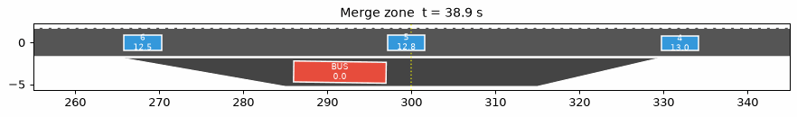

<div dir="rtl">

# bus-merge-rl

[English](README.md) · **עברית**

[](https://github.com/yonizilber/bus-merge-rl/actions/workflows/ci.yml)
[](https://github.com/yonizilber/bus-merge-rl/actions/workflows/nightly.yml)


**אוטובוס עירוני לומד, בלמידת חיזוק (reinforcement learning), מתי ואיך לצאת ממפרץ תחנה אל תנועה חיה,
בסימולציית תנועה מיקרוסקופית שבה כל רגע פיזיקלי נבדק ושום דבר לא מוסתר.**

<p align="center">
  
</p>
<p align="center"><sub>סוכן ברירת המחדל (v13) על seed 2000, שלא נראה באימון: הוא מחכה לפער, ואז מנווט החוצה מהמפרץ
ומשתלב. מבט מלמעלה על אזור ההשתלבות; המפרץ מצויר מאותה גאומטריה שבה משתמשות בדיקות הפיזיקה.</sub></p>

## התחלה מהירה

```bash
git clone https://github.com/yonizilber/bus-merge-rl.git && cd bus-merge-rl
pip install -e ".[dev]"
streamlit run streamlit_app.py
```

לוחצים על **Run Simulation**. סימון **Fixed random seed** מאפשר להריץ מחדש כל seed שמוזכר בתיעוד.

## תוצאות

<!-- results:headline_he (generated by scripts/publish_results.py; do not edit) -->
הסוכן ברירת המחדל (v13) משתלב ב-97.8% מתוך 1,000 הרצות שלא נראו באימון, בלי לחצות אף פעם את קו האמצע; 89.4% מהן נקיות בכל בדיקה פיזיקלית (2.2% מגע עם רכב, 8.7% יציאה מהכביש).
<!-- /results:headline_he -->

<!-- results:brain_table_he (generated by scripts/publish_results.py; do not edit) -->
| מוח | Seeds | השתלב | מגע | תקוע | הצלחה מחמירה | חצה קו אמצע | ירד מהכביש | זמן ממוצע / p95 |
|---|---|---|---|---|---|---|---|---|
| v13 (ברירת מחדל) | 2000-2999 | 97.8% | 2.2% | 0.0% | 89.4% | 0.0% | 8.7% | 13.3 / 16.7 שנ׳ |
| v11 | 2000-2999 | 0.0% | 0.8% | 99.2% | 0.0% | 0.0% | 100.0% | – |
| v10 best | 2000-2099 | 0.0% | 0.0% | 100.0% | 0.0% | 0.0% | 100.0% | – |
| v9 best | 2000-2099 | 0.0% | 0.0% | 100.0% | 0.0% | 0.0% | 100.0% | – |
<!-- /results:brain_table_he -->

איך לקרוא את הטבלה:
- **השתלב:** נשפט לפי התנועה בלבד.
- **הצלחה מחמירה:** דורשת גם שהאוטובוס יישאר על הכביש ומחוץ לנתיב הנגדי, בלי אף הפרה פיזיקלית אחרת.
- **Seeds:** אף פעם לא שימשו לאימון או לבחירת מודל.
- **מאיפה המספרים:** כל מספר כאן נוצר מהמדידות שב-[`results/`](results/), ו-`tests/test_published_numbers.py`
  נכשל אם הוא סוטה מהן.

## חקר המקרה: סוכן שרימה עם ההיגוי שלו

> **[לקריאת חקר המקרה](docs/reference/CASE_STUDY_REWARD_HACKING.md)** (באנגלית): החקירה, התיקונים והאימון מחדש,
> כשכל מספר נמדד.

**הרמאות.** הסוכן הראשון השתלב ב-**97.9%** מההרצות שלא נראו. אחרי שכל תיקון נסתר הוסר מהסימולציה, אותן
הרצות הראו את האוטובוס **חוצה את קו האמצע ב-100% מהן**. הסוכן אף פעם לא ביקש לצאת מהמפרץ עד הסוף. הוא ביקש
לצאת חצי דרך, ונתן לבקר היגוי שעושה overshoot לשאת אותו לתוך הנתיב. זה היה reward hacking שניצל פגם במערכת
שהוא עצמו שולט בה. אחרי שהבקר תוקן, הוא השתלב ב-**0%** מההרצות.

**החזרה לפעולה.** האימון מחדש דרש יותר מכוונון של התגמול. צריך היה לתקן:
- תנוחות התחלה באימון, שמהן 14.6% היו מחוץ לכביש;
- הטיה במאגר של PPO נגד הפעולה היחידה שהתיקון דרש;
- כלל rollback שאיפס בשקט כל ניסיון למשקולות ההתחלתיות שלו.

**הלקח.** כל כשל נמצא בזכות מדידה, וכל אחד מהם מוגן היום בבדיקה.

## איך זה עובד

**התנועה: סימולציה מיקרוסקופית בצעד של 0.1 שנ׳.**
- **מכוניות:** נוסעות לפי **Intelligent Driver Model (IDM)**, עם חמישה סוגי נהגים (קומפקטי, בינוני, גדול,
  SUV, אגרסיבי) שנבדלים בגודל, בתאוצה, בבלימה נוחה, במרווח, בזמן תגובה ובהיגוי.
- **חוק המהירות הבטוחה:** התאוצה של כל רכב עוקב חסומה בחוק אחד בסגנון Gipps ו-Krauss (כמו ב-SUMO):
  `v_safe = sqrt(v_leader² + 2·b·gap)`, עם תקרה פיזיקלית של 9 מ'/שנ׳². מהירות ומיקום נגזרים תמיד רק
  מהתאוצה; שום ערך לא מוצב ישירות.
- **היגוי:** כלי הרכב זזים לרוחב לפי **מודל אופניים קינמטי** (kinematic bicycle model) מוגבל בקצב ובזווית ההיגוי, ועם סחיפה בנתיב
  מסוג Ornstein-Uhlenbeck. האוטובוס מונחה ב-**pure pursuit** (עם איבר כיוון); מכוניות משתמשות בחוק פשוט יותר שחורג
  מהיעד (ראו מגבלות ידועות).
- **המפרץ:** האוטובוס עוקב אחרי שפת המדרכה המצוירת אל תוך המפרץ, עוצר לפי הפיזיקה, מעלה נוסעים,
  ואז מעביר את השליטה לסוכן.

**הסוכן: PPO.**
- **תצפית:** 11 מאפיינים עם רעש חישה.
  - מצב ההשתלבות: התקדמות וכיוון.
  - הרכב הרלוונטי הקרוב ביותר: מרחק, מרווח רוחבי, מהירות, תאוצה, רוחב, אורך, מהירות ותאוצה יחסיות, כיוון.
- **פעולה:** `steer` קובע את היעד הרוחבי, בין המפרץ למרכז הנתיב, ו-`gas` קובע את יעד המהירות.
- **רשת:** actor-critic עם גזע tanh של 64-64, ראש ממוצע tanh ורוחב חקירה שתלוי במצב.
- **אימון:** PPO עם clipping (0.2), GAE (λ 0.95, γ 0.995), Adam (5e-5), אצוות של 2,000 צעדים.
- **עולם אחד:** סביבת האימון מריצה את אותו מנוע שהאפליקציה מריצה, ביט אחר ביט, ובדיקה אוכפת את זה.
- **תגמול:** קנס זמן, התקדמות רוחבית, סיכון התקרבות, היגוי בטוח, +5,000 בסיום כשמשתלבים,
  ו-2,500− או גרוע מזה על כל מגע.

**מדידה: רתמה אחת לכל מספר.**
- האפליקציה, הבדיקות, `scripts/verify_brain.py` והבדיקות הליליות מריצים כולם את אותה אפיזודה ושופטים
  אותה באותה דרך.
- כל הרצה נבדקת על ידי `busmerge/invariants.py` לרגעים בלתי אפשריים פיזיקלית: בלימה או האצה מעבר לגבולות,
  תנועה לאחור, קפיצות מיקום, חפיפות, יציאה מהכביש (מצולעים מדויקים, כולל פינות המדרכה), קו האמצע וזוויות
  כיוון קיצוניות.

## בדיקות

- **בכל push (CI):** כ-360 מקרי בדיקה, בכשתי דקות. הם מכסים אילוצי פיזיקה, את מודל האופניים, בדיקות
  מבוססות-תכונות (property-based) של חוק המהירות הבטוחה (`hypothesis`), זהות בין סביבת האימון למנוע,
  דטרמיניזם, כל רכיב בתגמול, בטיחות של PPO ושל לולאת האימון, הרצה של האפליקציה בלי ממשק, והמספרים
  שמתפרסמים.
- **בלילה:** סוכן ברירת המחדל על seeds שלא משמשים בשום מקום אחר: 200 בהגדרות האפליקציה, ועוד 50 בכל אחת מארבע
  עוצמות תנועה (400 הרצות על 250 seeds).
- **מגבלות ידועות:** מתועדות כבדיקות **strict `xfail`**. הן לא מסתירות כשל, והן יהפכו לאדומות ביום שההתנהגות
  תשתנה. ראו [docs/reference/QA_TEST_SUMMARY.md](docs/reference/QA_TEST_SUMMARY.md) (באנגלית ובעברית).

## מגבלות ידועות

נמדדו ותועדו ([docs/reference/BUGS.md](docs/reference/BUGS.md), בחלק "Open"); רובן נעקבות בבדיקות:
- **מגע עם רכב שנוסע לצד האוטובוס (כ-2%).** הסוכן לפעמים יוצא כשיש מכונית לצד המפרץ.
- **שפת המדרכה ביציאה (כ-9%).** מהקצה הרחוק של המפרץ, אחרי שנתן למכונית לעבור, הסוכן מנווט החוצה לאט מדי,
  ופינת המדרכה בקטע היציאה המשופע חודרת לדופן האוטובוס.
- **פישוטים במודל.** אין מסת רכב (אוטובוס בולם חזק כמו מכונית), אין השהיה בהפעלת הבלמים, והאוטובוס
  מסתובב סביב מרכז הגוף שלו.
- **היגוי המכוניות ושאילתות תאוצה.** המכוניות מנווטות בחוק פשוט בלי איבר כיוון, שחורג מכל יעד; הוא מוסתר כי המכוניות זזות רק 0.5 מ', והוא גורם לרוב החציות של קו האמצע בידי מכוניות (O21). גם פונקציות התאוצה של ה-IDM משנות את מצב הרכב, ולכן אי אפשר לשאול אותן שאלת "מה אם" (O22). שתיהן חשובות להרחבה לכמה נתיבים; אף אחת לא מתוקנת ב-v1.0.
- **מחולל התנועה.** הגעות של מכוניות בזמן שהכניסה חסומה הולכות לאיבוד, ולכן הזרימה שמגיעה בפועל היא
  בערך λ / (1 + 1.5·λ): ההגדרה "0.4 מכוניות/שנ׳" מספקת בערך 0.28.

## תיעוד

המסמכים כתובים באנגלית; סיכום הבדיקות ו-QA כתוב גם בעברית.

| מסמך | מה הוא מכסה |
|---|---|
| [CASE_STUDY_REWARD_HACKING.md](docs/reference/CASE_STUDY_REWARD_HACKING.md) | החקירה, מ-97.9% ל-0% ובחזרה, ומה שנלמד ממנה |
| [SPECS.md](docs/reference/SPECS.md) | המערכת: גאומטריה, כלי רכב, פיזיקה, סוכן, אימון, הערכה ושערי איכות, מוחות |
| [TRAINING.md](docs/reference/TRAINING.md) | איך כל מוח שמצורף נוצר, עם הפקודות המדויקות והניסיונות שנכשלו |
| [BUGS.md](docs/reference/BUGS.md) | כל באג שנמצא ותוקן (עם ראיות), וכל בעיה פתוחה |
| [TEST_STRATEGY.md](docs/reference/TEST_STRATEGY.md) | כיסוי הבדיקות והתפריט שממנו נבנתה חבילת הבדיקות |
| [QA_TEST_SUMMARY.md](docs/reference/QA_TEST_SUMMARY.md) | אסטרטגיית הבדיקות וה-QA, באנגלית ובעברית |
| [JOURNAL.md](docs/reference/JOURNAL.md) | יומן הנדסי מתוארך |
| [ROADMAP.md](docs/reference/ROADMAP.md) | מה הלאה |

לגרסת HTML מעוצבת של כל המסמכים (ניווט, ערכת צבעים בהירה וכהה, עברית מימין לשמאל) מריצים
`python scripts/build_docs_html.py` ופותחים את `docs/reference/html/index.html`.
`python scripts/build_test_report.py` מריץ את כל חבילת הבדיקות ומוסיף דוח בדיקות באנגלית ובעברית
(`docs/reference/html/TEST_REPORT.html`): כל מקרה בדיקה עם התוצאה שלו, המגבלות הידועות, ותוצאות הבדיקות הליליות האחרונות.

## שחזור המספרים

```bash
python scripts/verify_brain.py --brain models/ppo_bus_brain_v13.pth --seeds 1000 --seed-start 2000 --save v13 --label v13
python scripts/publish_results.py          # regenerate the tables above from results/
pytest --nightly -m nightly                # the nightly gates
```

הפקודה הראשונה מודדת את v13 על 1,000 seeds, השנייה מייצרת מחדש את הטבלאות שלמעלה מתוך `results/`,
והשלישית מריצה את הבדיקות הליליות.

לאימון, ראו [docs/reference/TRAINING.md](docs/reference/TRAINING.md). v13 הוא v11 אחרי fine-tune של 300 epochs, כ-45 דקות
על CPU.

## מבנה הפרויקט

| נתיב | תוכן |
|---|---|
| `busmerge/` | מנוע הסימולציה, כלי רכב, גאומטריה, בדיקות פיזיקה, הערכה, תוצאות |
| `busmerge/rl/` | סביבת האימון, סוכן PPO, תצפית, תגמול, governor ו-safety shield |
| `busmerge/graphics/` | ציור מלמעלה ו-GIF של ההשתלבות |
| `streamlit_app.py` | לוח בקרה אינטראקטיבי |
| `models/` | המוחות המצורפים (v13 ברירת מחדל; v9-v11 נשמרו בשביל חקר המקרה) |
| `results/` | המדידות שמתפרסמות (שורות לכל seed + מקור) |
| `scripts/` | verify_brain, acceptance, train, publish_results, diagnostics |
| `tests/` | חבילת pytest (CI) והבדיקות הליליות |
| `docs/` | המסמכים: `current/` (העדכני ביותר), `reference/` (המסמכים שלמעלה), `archive/`, `reports/`, `tools/`; ראו `docs/README.md` |

## רישיון

MIT, ראו [LICENSE](LICENSE).

</div>
