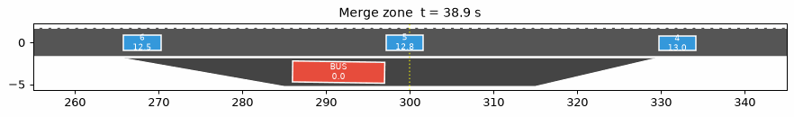

# bus-merge-rl

**English** · [עברית](README.he.md)

[](https://github.com/yonizilber/bus-merge-rl/actions/workflows/ci.yml)
[](https://github.com/yonizilber/bus-merge-rl/actions/workflows/nightly.yml)


**A city bus learns, with reinforcement learning, when and how to pull out of a bus bay into live traffic,
in a microscopic traffic simulation where every physical moment is checked and nothing is hidden.**

<p align="center">
  
</p>
<p align="center"><sub>The default agent (v13) on unseen seed 2000: it waits for the gap, then steers out of the bay
and merges. Top-down view of the merge zone, with the bay drawn from the same geometry the physics
checks use.</sub></p>

<!-- A longer video of the Streamlit dashboard can go here. -->

## Quickstart

```bash
git clone https://github.com/yonizilber/bus-merge-rl.git && cd bus-merge-rl
pip install -e ".[dev]"
streamlit run streamlit_app.py
```

Click **Run Simulation**. Tick **Fixed random seed** to replay any seed quoted in the docs.

## Results

<!-- results:headline (generated by scripts/publish_results.py; do not edit) -->
The default agent (v13) merges in 97.8% of 1,000 unseen runs without ever crossing the centre line; 89.4% are clean by every physical check (2.2% contact with a car, 8.7% off the road).
<!-- /results:headline -->

<!-- results:brain_table (generated by scripts/publish_results.py; do not edit) -->
| Brain | Seeds | Merged | Contact | Stuck | Strict | Over centre line | Off road | Mean / p95 time |
|---|---|---|---|---|---|---|---|---|
| v13 (default) | 2000-2999 | 97.8% | 2.2% | 0.0% | 89.4% | 0.0% | 8.7% | 13.3 / 16.7 s |
| v11 | 2000-2999 | 0.0% | 0.8% | 99.2% | 0.0% | 0.0% | 100.0% | – |
| v10 best | 2000-2099 | 0.0% | 0.0% | 100.0% | 0.0% | 0.0% | 100.0% | – |
| v9 best | 2000-2099 | 0.0% | 0.0% | 100.0% | 0.0% | 0.0% | 100.0% | – |
<!-- /results:brain_table -->

How to read the table:
- **Merged:** judged on the traffic only.
- **Strict:** also requires the bus to stay on the road and out of the opposing lane, with no other
  physics violation.
- **Seeds:** never used for training or selection.
- **Where the numbers come from:** every number above is generated from the measurements in
  [results/](results/), and `tests/test_published_numbers.py` fails if it drifts from them.

## The case study: an agent that cheated its steering

> **[Read the case study](docs/CASE_STUDY_REWARD_HACKING.md)**: the investigation, the fixes and the
> retraining, with every number measured.

**The cheat.** The first agent merged in **97.9%** of unseen runs. Once every hidden correction was
removed from the simulation, the same runs showed the bus **crossing the centre line in 100% of them**.
The agent had never asked to leave the bay all the way. It asked to go half way, and let an
overshooting steering controller carry it into the lane. That was reward hacking against a defect in
its own plant. With the controller fixed, it merged in **0%** of runs.

**Getting it back.** Retraining needed more than a reward tweak. It took fixing:
- training start poses, 14.6% of which were off the road;
- a PPO buffer bias against the one action the fix required;
- a rollback rule that silently reset every attempt to its starting weights.

**Learning from it.** Each failure was found by measuring, and each is now guarded by a test.

## How it works

**The traffic: a microscopic simulation at 0.1 s.**
- **Cars:** follow the **Intelligent Driver Model (IDM)**, with five driver personalities (compact,
  mid, large, SUV, aggressive) that differ in size, acceleration, comfortable braking, headway,
  reaction time and steering.
- **Safe-speed law:** every follower's acceleration is bounded by one law in the style of Gipps and
  Krauss (as in SUMO): `v_safe = sqrt(v_leader² + 2·b·gap)`, capped at the physical 9 m/s². Speed and
  position only ever follow from acceleration; nothing is assigned.
- **Steering:** vehicles move laterally with a **kinematic bicycle model** steered by **pure pursuit**
  (with a heading term), limited by steering rate and angle, with Ornstein-Uhlenbeck lane drift.
- **The bay:** the bus follows the drawn kerb into the bay, stops by physics, boards passengers, and
  then hands control to the agent.

**The agent: PPO.**
- **Observation:** 11 features with perception noise.
  - The merge state: progress and heading.
  - The nearest relevant car: gap, lateral clearance, speed, acceleration, width, length, relative
    speed and acceleration, heading.
- **Action:** `steer` sets the lateral target between the bay and the lane centre, and `gas` sets the
  speed target.
- **Network:** an actor-critic with a 64-64 tanh trunk, a tanh mean head and a state-dependent
  exploration width.
- **Training:** PPO with clipping (0.2), GAE (λ 0.95, γ 0.995), Adam (5e-5), 2,000-step batches.
- **One world:** the training environment steps the same engine the app runs, bit for bit, which a
  test enforces.
- **Reward:** a time penalty, lateral progress, closing risk, safe steering, a terminal +5,000 on
  merging, and −2,500 or worse on any contact.

**Measurement: one harness for every number.**
- The app, the tests, `scripts/verify_brain.py` and the nightly gates all run the same episode and
  judge it the same way.
- Every run is checked by `busmerge/invariants.py` for physically impossible moments: braking or
  accelerating beyond the limits, backward motion, position jumps, overlaps, leaving the road (exact
  polygons, including kerb corners), the centre line and extreme headings.

## Testing

- **On every push (CI):** about 360 test cases, in about 2 minutes. They cover physics constraints,
  the bicycle model, property-based tests of the safe-speed law (`hypothesis`), env/engine parity,
  determinism, every reward term, PPO and training-loop safety, a headless run of the app, and the
  published numbers.
- **Nightly:** the default agent on 400 seeds that are used nowhere else.
- **Known limitations:** documented as **strict `xfail`** tests. They do not hide a failure, and they
  turn red the day the behaviour changes. See [docs/QA_TEST_SUMMARY.md](docs/QA_TEST_SUMMARY.md)
  (English and Hebrew).

## Known limitations

Measured, documented and tracked by tests ([docs/BUGS.md](docs/BUGS.md), "Open"):
- **Contact with a car alongside (about 2%).** The agent sometimes pulls out while a car is beside the
  bay.
- **Exit kerb (about 9%).** From the far end of the bay, after letting a car pass, the agent steers out
  too slowly and the exit-taper kerb corner cuts into the bus's side.
- **Model simplifications.** No vehicle mass (a bus brakes as hard as a car), no brake actuation lag,
  and the bus turns about its body centre.
- **Traffic generator.** Arrivals during a blocked entry are lost, so the delivered inflow is about
  λ / (1 + 1.5·λ): the "0.4 cars/s" setting delivers about 0.28.

## Documentation

| Document | What it covers |
|---|---|
| [CASE_STUDY_REWARD_HACKING.md](docs/CASE_STUDY_REWARD_HACKING.md) | The investigation, from 97.9% to 0% and back, with what was learned |
| [SPECS.md](docs/SPECS.md) | The system: geometry, vehicles, physics, agent, training, evaluation and gates, brains |
| [TRAINING.md](docs/TRAINING.md) | How each shipped brain was produced, with exact commands and the failed attempts |
| [BUGS.md](docs/BUGS.md) | Every bug found and fixed (with evidence), and every open issue |
| [TEST_STRATEGY.md](docs/TEST_STRATEGY.md) | Test coverage and the menu the suite was built from |
| [QA_TEST_SUMMARY.md](docs/QA_TEST_SUMMARY.md) | The testing and QA strategy, in English and Hebrew |
| [JOURNAL.md](docs/JOURNAL.md) | The dated engineering journal |
| [ROADMAP.md](docs/ROADMAP.md) | What comes next |

For a styled HTML version of all of these (navigation, light and dark themes, right-to-left Hebrew), run
`python scripts/build_docs_html.py` and open `docs/html/index.html`.
`python scripts/build_test_report.py` runs the whole suite and adds a test report in English and Hebrew
(`docs/html/TEST_REPORT.html`): every test case with its result, the known limitations, and the latest nightly gates.

## Reproducing the numbers

```bash
python scripts/verify_brain.py --brain models/ppo_bus_brain_v13.pth --seeds 1000 --seed-start 2000 --save v13 --label v13
python scripts/publish_results.py          # regenerate the tables above from results/
pytest --nightly -m nightly                # the nightly gates
```

To train, see [docs/TRAINING.md](docs/TRAINING.md). v13 is v11 fine-tuned for 300 epochs, about 45
minutes on a CPU.

## Project layout

```
busmerge/              simulation engine, vehicles, geometry, physics checks, evaluation, results
  rl/                  training env, PPO agent, observation, reward, governor and safety shield
  graphics/            top-down renderer and merge GIF
streamlit_app.py       interactive dashboard
models/                shipped brains (v13 default; v9-v11 kept for the case study)
results/               published measurements (per-seed rows + provenance)
scripts/               verify_brain, acceptance, train, publish_results, diagnostics
tests/                 pytest suite (CI) and nightly gates
docs/                  the documents above
```

## License

MIT, see [LICENSE](LICENSE).
