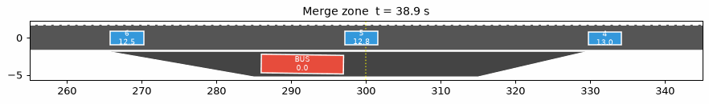
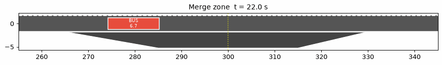

# bus-merge-rl

[](https://github.com/yonizilber/bus-merge-rl/actions/workflows/ci.yml)
[](https://github.com/yonizilber/bus-merge-rl/actions/workflows/nightly.yml)


**Should a city bus stop in a bay, or in the lane? This project builds the instrument to answer that: a
microscopic traffic simulation in which nothing is hidden, and a bus driver trained with reinforcement learning[^ppo] to leave the bay the way a real driver does.**

## Quick start

```bash
git clone https://github.com/yonizilber/bus-merge-rl.git && cd bus-merge-rl
pip install -e ".[dev]"
streamlit run streamlit_app.py
```

Click **Run Simulation**. Tick **Fixed random seed** to replay any seed quoted in these pages.

## Why this project

Every city has to decide where its buses stop. Two designs compete:

<p align="center">
  
</p>
<p align="center"><sub><b>Stopping in a bay.</b> The cars keep moving while passengers board. When boarding ends the bus
must find a gap and merge back, and the traffic decides how long that takes. Here the trained driver waits for a gap,
then pulls out.</sub></p>

<p align="center">
  
</p>
<p align="center"><sub><b>Stopping in the lane.</b> The bus never has to merge, and can stop exactly at the kerb, but every
car behind it waits until boarding ends: a queue forms.</sub></p>

**The question is not which option is better for the bus, but which one moves more people faster**, counting the
50 passengers on the bus and the 1.2 people in an average car. It depends on how dense the traffic is, how long the
bus stands at the stop in each design, how many people ride in each car, and how long a merge really takes. The
[research question](RESEARCH.md) page sets out the experiment, and the [results](RESULTS.md) tell what it showed: in short, **a
short stop favours the lane, a long stop or dense traffic favours the bay, and the tipping point moves with every assumption.**

**The hard part is the merge.** A comparison is only as good as its weakest model, and the weakest point of most
traffic simulations is exactly here: a bus leaving a bay into live traffic, which depends on judgement, not on a
formula. So the project has two parts:
- **A world:** a microscopic traffic simulation, every car an IDM[^idm] driver, every vehicle moving by a
  kinematic bicycle model[^bicycle], with no hidden corrections: anything physically impossible is checked for and
  reported. See [World model](WORLD.md).
- **A driver:** a PPO[^ppo]-trained neural network[^actor_critic] that decides when and how to leave the bay. See
  [Agent](AGENT.md).

## The result: a bus driver that behaves like a real one

The test of realism is simple: a real bus driver leaves the bay **without getting stuck**, **without driving into the
opposing lane**, and **almost never touches a car**. Measured on 1,000 traffic situations the driver never saw in
training:

<!-- results:headline_semver (generated by scripts/publish_results.py; do not edit) -->
Brain 0.13.0, the default and the only working brain, merges in 97.8% of 1,000 unseen runs. It never gets stuck (0.0%) and never crosses the centre line (0.0%); 2.2% of runs end in contact with a car. 89.4% of runs are clean by every physical check.
<!-- /results:headline_semver -->

<!-- results:brain_table_semver (generated by scripts/publish_results.py; do not edit) -->
| Brain | Status | Seeds | Merged | Contact | Stuck | Strict success | Over centre line | Off road | Mean / p95 time |
|---|---|---|---|---|---|---|---|---|---|
| **0.13.0** | ✔ **Working** (default) | 2000-2999 | 97.8% | 2.2% | 0.0% | 89.4% | 0.0% | 8.7% | 13.3 / 16.7 s |
| 0.11.0 | ✘ Superseded: stops half way | 2000-2999 | 0.0% | 0.8% | 99.2% | 0.0% | 0.0% | 100.0% | – |
| 0.10.0 (best checkpoint) | ✘ Superseded: stops half way | 2000-2099 | 0.0% | 0.0% | 100.0% | 0.0% | 0.0% | 100.0% | – |
| 0.9.0 (best checkpoint) | ✘ Superseded: stops half way | 2000-2099 | 0.0% | 0.0% | 100.0% | 0.0% | 0.0% | 100.0% | – |
<!-- /results:brain_table_semver -->

How to read it:
- **Brain 0.13.0 is the one to use.** It is the default in the app and the only version that works on the current
  simulation. The older versions are kept because the [case study](CASE_STUDY.md) needs them as evidence: they were
  trained on a simulation with a steering defect and learned to rely on it.
- **Merged** is judged on the traffic only. **Strict success[^strict]** also requires the bus to stay on the road,
  out of the opposing lane, with no other physics violation.
- **Contact (2.2%) and off road (8.7%)** are real failures of the driver, not noise. A real bus driver collides far
  less often than once in 50 pull-outs, so these are reported as [limitations](LIMITATIONS.md), not as realism. That
  they are visible at all is the point of a simulation without hidden corrections.
- Every number on this page is generated from stored measurements (`results/`), and a test fails if a page differs.

## Why the numbers can be trusted

- **One engine.** Training, the app, the tests and every published number run the same simulation code, checked bit
  for bit by a test. Most early bugs in this project were differences between two copies of the same world.
- **Nothing hidden.** Speeds and positions follow only from accelerations; nothing is corrected by assignment. Every run
  is checked for physically impossible moments (physics checks[^invariants]), and failures are reported, not clamped.
- **A bug the agent exploited, found and fixed.** The first version of the driver scored 97.9% because it had learned to
  exploit a steering defect. Finding it took removing every hidden correction; fixing it took repairing the controller
  and two training bugs. The [case study](CASE_STUDY.md) tells the story.
- **Measured on unseen data.** Training, selection, publication and the scheduled gates use separate sets of random
  seeds.
- **430 automated test cases.** All but the five slow statistical gates run on every push, and the rule for the
  main branch is that a change is merged only when they pass. Known limitations are kept as strict xfail[^strict_xfail] tests, so they
  stay visible and turn red the day the behaviour changes. See [Testing](TESTING.md).

## Pages

| Page | What it covers |
|---|---|
| [Research question](RESEARCH.md) | Bay or lane: the question, the measures, the factors and the experiment |
| [Results](RESULTS.md) | What 15,000 simulated runs showed: what the bay costs, what it buys, and who wins where |
| [World model](WORLD.md) | The road, the cars, the bus and the bay, and the physics that holds it together |
| [Agent](AGENT.md) | What the driver sees, what it decides, its network, how it learns, and every version |
| [Case study](CASE_STUDY.md) | How an agent that exploited a steering bug was found out and replaced |
| [Changelog](CHANGELOG.md) | Every release and fix, with the commit that made it |
| [Testing](TESTING.md) | The test status, what is tested, and the rules for merging |
| [Limitations](LIMITATIONS.md) | Every known issue in plain words, with the test that tracks it |
| Test report (HTML site) | Every test case with its result, from one real run |
| [Glossary](GLOSSARY.md) | The technical terms used on these pages |

## Versions

| Component | Version | Status |
|---|---|---|
| Simulation (the `busmerge` package) | 1.0.1 | Released. Semantic versioning: the next breaking change to the physics is 2.0.0 |
| Brain (the driver) | 0.13.0 | Working, the default. Major version 0: it does not yet pass every acceptance criterion |

The [changelog](CHANGELOG.md) explains the scheme and lists every version.

## Reproducing the numbers

```bash
python scripts/verify_brain.py --brain models/ppo_bus_brain_v13.pth --seeds 1000 --seed-start 2000 --save v13 --label v13
python scripts/publish_results.py          # regenerate the tables above from results/
pytest --nightly -m nightly                # the scheduled gates, on demand
```

Brain 0.13.0 is stored as `models/ppo_bus_brain_v13.pth`; it was fine-tuned from 0.11.0 for 300 epochs, about 45
minutes on a CPU.

## Project layout

```
busmerge/              simulation engine, vehicles, geometry, physics checks, evaluation, results
  rl/                  training environment, PPO agent, observation, reward, governor and safety shield
  graphics/            top-down renderer and merge GIF
streamlit_app.py       interactive dashboard
models/                brains (0.13.0 is the default; older versions are kept for the case study)
results/               published measurements (per-seed rows + provenance)
scripts/               verify_brain, acceptance, train, publish_results, diagnostics
tests/                 the test suite and the scheduled gates
```

## License

MIT.

[^ppo]: **PPO (Proximal Policy Optimization).** A reinforcement-learning method that improves the policy in small, safe steps by limiting how far one update can move it. A rollout of 2,000 steps is collected; then the network is updated several times on it. Each update compares how likely every action is now with how likely it was when it was taken, and does not let that ratio move far from 1. [more](GLOSSARY.md#ppo)
[^idm]: **IDM (Intelligent Driver Model).** A car-following model: acceleration depends on the car's speed, its desired speed, and the gap and speed difference to the car ahead. Treiber, Hennecke and Helbing proposed it in 2000. Every car in the simulation is an IDM driver with its own parameters, and the bus follows the same model when it drives in the lane. [more](GLOSSARY.md#idm)
[^bicycle]: **Bicycle model (kinematic).** A car reduced to two wheels, the front one steering: the heading turns at speed × tan(steering angle) / wheelbase. Every car and the bus move sideways this way. The steering angle changes the heading, the heading changes the sideways position, and steering is limited in angle and in rate, so a vehicle cannot jump sideways. "Kinematic" means that only geometry is modelled, with no tyre forces or mass. [more](GLOSSARY.md#bicycle)
[^actor_critic]: **Actor-critic network.** The agent's neural network: an actor that chooses the two actions, and a separate critic that estimates how good the situation is. The actor is the policy; the critic only helps training (it estimates the expected return, used to judge actions). When the brain drives in the app or in a measurement, only the actor is used and it acts on its mean, so the same state always gives the same action. [more](GLOSSARY.md#actor_critic)
[^strict]: **Strict success.** Merged, and in addition no physical anomaly: the bus stayed on the road, out of the opposing lane, with no contact or other violation. It is the honest measure. For brain 0.13.0 it is 89.4% of 1,000 unseen runs, against 97.8% merged. [more](GLOSSARY.md#strict)
[^invariants]: **Invariants (physics checks).** Checks run on every simulated run for moments that cannot happen in reality. A run is not judged only by its outcome. `busmerge/invariants.py` goes over the whole frame log and reports every impossible moment. Cars crossing the centre line or the kerb are reported but not failed (mostly the overshoot of their steering law when they move over for the bus, limitation O21). [more](GLOSSARY.md#invariants)
[^strict_xfail]: **Strict xfail.** A test for a known limitation: it keeps its honest assertion, must fail on that assertion, and turns red the day the behaviour changes. Deleting the test or loosening its threshold would hide the limitation. With strict xfail it stays in the suite, next to the code, and it cannot silently start passing or break for another reason. [more](GLOSSARY.md#strict_xfail)
