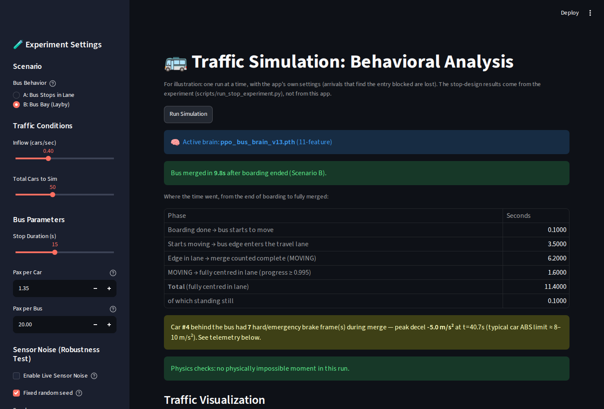
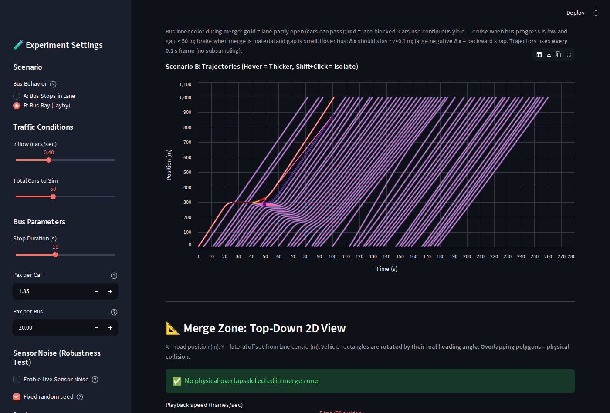

[Overview](README.md) · [Research question](RESEARCH.md) · [Measurements and research](EXPLORER.md) · [Conclusions](RESULTS.md) · [Field data](FIELD_DATA.md) · [World model](WORLD.md) · [Agent](AGENT.md) · [Case study](CASE_STUDY.md) · **The app** · [Changelog](CHANGELOG.md) · [Testing](TESTING.md) · [Limitations](LIMITATIONS.md) · [Glossary](GLOSSARY.md) · [עברית](../he/APP.md)

> **Read this on the website**, where the tabs switch in place and the interactive explorer works: [https://yonizilber.github.io/bus-merge-rl/en/APP.html](https://yonizilber.github.io/bus-merge-rl/en/APP.html)

# The app

The app (Streamlit) runs one simulation run with the settings you choose and shows it in detail: how long the bus took to
merge, where the time went, and how every vehicle moved. [Measurements and research](EXPLORER.md) summarises thousands of
runs; the app shows one.

The app runs on your own computer, not on this site or on GitHub. How to install and start it: the
[quick start](README.md#quick-start) on the overview.

This is how it looks after one run with the default settings (bay, 0.40 cars/s, a 15 s stop, seed 0):

*On the side you choose the scenario (A: stop in the lane, B: bay), the traffic, the stop time and the occupancies. At
the top the app reports how long the bus took to merge after boarding ended, breaks that time into phases, and flags
hard braking and physically impossible moments (none here).*

*Each line is one vehicle: its position along the road (metres, vertical axis) over time (seconds). A steep line is fast
driving; a line that flattens is a vehicle standing still. The bus stops in the bay at about 300 m; the other lines are
the cars. Below the chart is a top-down view of the merge zone.*

---

[Overview](README.md) · [Research question](RESEARCH.md) · [Measurements and research](EXPLORER.md) · [Conclusions](RESULTS.md) · [Field data](FIELD_DATA.md) · [World model](WORLD.md) · [Agent](AGENT.md) · [Case study](CASE_STUDY.md) · **The app** · [Changelog](CHANGELOG.md) · [Testing](TESTING.md) · [Limitations](LIMITATIONS.md) · [Glossary](GLOSSARY.md) · [עברית](../he/APP.md)
