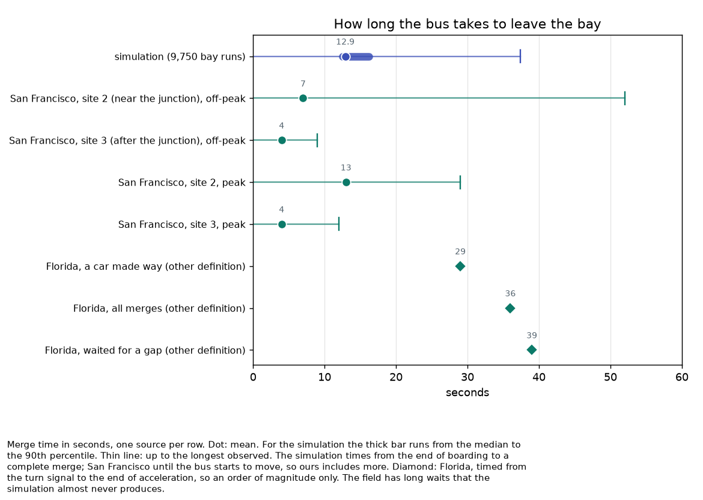
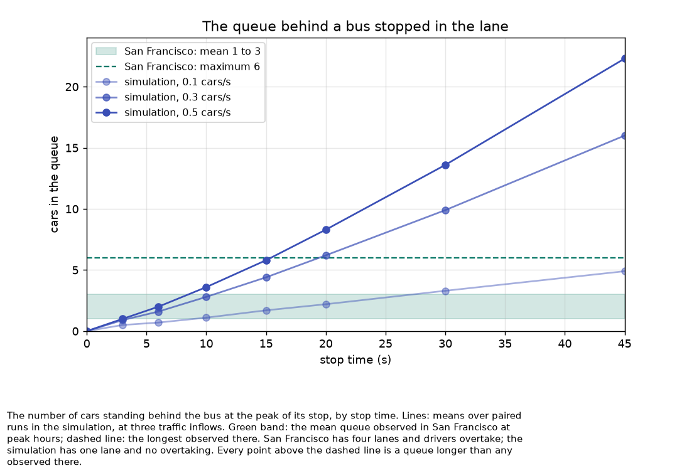
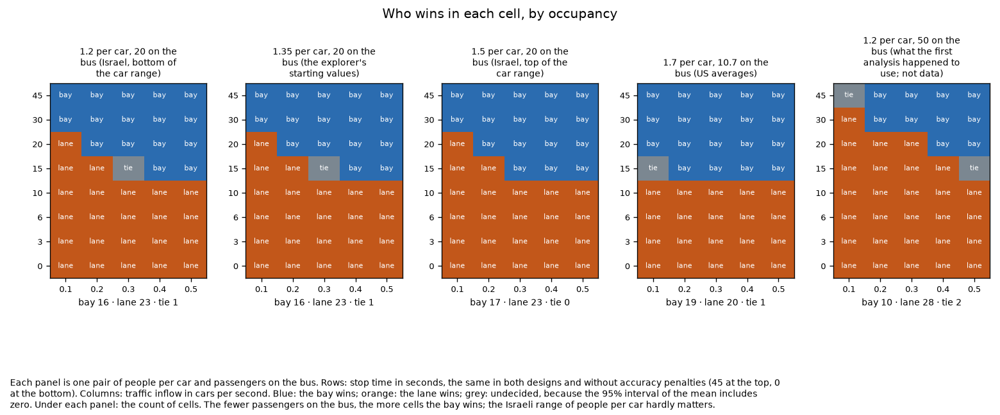

# Field data: the simulation against real streets

> **A literature review, not a recalibration.** First written on 2026-11-01, updated on 2026-11-10 for both experiments
> (19,500 runs). Does what the simulation shows about a bus stopping in a bay or in the lane look like what has
> been measured on real streets? We checked first what the simulation **produces** (the bus's loss, the merge, the
> queue, the entry flow), then what it only **takes as input** (stop time, people per car and on the bus).
>
> *Read*: we downloaded the report and read the numbers in it. *Summary only*: we saw only a search summary or an
> abstract; check it against the source before quoting. *Second-hand*: quoted by a paper we read.

## In short

The general direction is supported: a bay costs the bus a few seconds at every stop, and a stop in the lane costs the
cars behind it, more as the stop gets longer. A few things do not reproduce, and one depends on an assumption we chose.
The simulation also models no extra difficulty in entering a bay and lining up in it, so the
[explorer](EXPLORER.md) adds that as assumptions you can change.

- **The bay's cost to the bus is at the upper end of the measurements.** 5.3 to 10.5 s in the
  simulation; about 2 to 6 s measured in the field. If the real cost is lower, the bay is better than the simulation
  shows.
- **No long tail in the merge.** The mean (12.9 s) is plausible, but the waits of 30 to 50 s measured in the
  field almost never occur in the simulation: 1 of 9,750 bay runs.
- **The long queues come from having one lane.** In the field drivers overtake, and the mean queue is 1 to 3 cars; ours
  reaches 22.
- **Cars enter the road about a third slower** than the standard saturation flow.
- **The verdict depends on the bus load much more than on the people per car.** The Israeli range of 1.2 to 1.5 people
  per car changes a cell or two; the number of bus passengers changes many.

## The verdict, question by question

| Question | The simulation | The field | Verdict |
|---|---|---|---|
| What the bay costs the bus | 5.3 to 10.5 s per stop, mean 7.0 | Singapore: +1.6 s in acceleration (*read*). Ottawa: 4 to 5 s (*second-hand*) | At the upper end of the measurements |
| Entering and aligning in the bay | No difference from the lane: −0.03 s; 2.8 m from the stop pole in both | Deceleration longer by 0.3 s (Singapore, *read*), 1.4 s (Beijing), 1 to 2 s (Ottawa); each passenger 0.19 s slower (Singapore) | Missing in the simulation; the explorer adds it |
| The merge | Mean 12.9 s, at most 37.4 | San Francisco: 4 to 13 s, up to 52 (*read*). Florida: 36 s, measured differently (*read*) | A plausible mean, no long tail |
| The queue behind a bus in the lane | 0 to 22 cars | San Francisco: 1 to 3 on average, at most 6 (*read*) | Matches only for short stops |
| Cars entering the road | 1,231 an hour | Saturation flow: 1,900 an hour per lane (*summary only*) | About a third low |
| The cars' loss from a stop in the lane | 2 to 4 s per car at 15 s | Ottawa: about 4 s per car (*summary only*) | The same order of magnitude |
| Stop time | Chosen directly, 0 to 45 s | No Israeli measurement. Measurements abroad come from other systems; in Israel, app validation and boarding at every door since 2015 (*read*) | No data from Israel; the tool does not guess |
| People per car | The reader's choice; 1.35 where one value is needed | Israel: 1.44 to 1.52 in surveys (*read*), 1.2 in the press (no source). USA: 1.18 to work, 1.67 for all trips | Within the range |
| People on the bus | The reader's choice | USA: 10.7 on average (*read*). Israel: load factors only; about 20 per city trip (*summary only*) | An estimate, not a measurement |

## Part A: what the simulation produces

### 1. What the bus loses in a bay

**The simulation:** the bus's trip is 5.3 to 10.5 s longer with a bay than with a stop in the lane,
in all 40 cells (the same stop time in both designs), about 7.0 s on average.

**The field.** A study in Singapore (*read*; 16 stops in eight pairs of a bay and a kerbside stop, peak hours, 2014,
2,653 records, sites without heavy traffic) found acceleration including pulling out of 11.35 s at a bay (standard
deviation 4.3) against 9.73 s at the kerb (1.9), and deceleration of 8.84 s against 8.53. The paper also quotes Ottawa:
acceleration and pulling out longer by 4 to 5 s at a bay, and deceleration longer by 1 to 2 s. The Ottawa pages
themselves (the Genivar consultants' report, 2011) no longer open and lead to an empty page; the search summaries that
quote them disagree (5 to 6 s, or 13 s), so all we can say is "the same order of magnitude".

**Verdict:** the measured range is about 2 to 6 s, and the simulation is at its upper end. In the simulation the cost
grows with the traffic; the Singapore sites were chosen without heavy traffic.

**Entering the bay itself.** We measured it in the simulation on 40 pairs of runs with the same entry
speed and the same stopping point: the time from the start of braking until the bus stands is the same in both designs
(−0.03 s), and the distance from the stop pole (2.8 m) and the gap to the kerb
(0.50 m in the lane, 0.46 m in the bay) are almost the same. So the simulation does not model
the extra difficulty of lining a bus up in a bay. In the field, deceleration into a bay is longer by 0.3 to 1.4 s, and
the explorer's starting values add one second for entering, one metre of distance and 0.4 m of gap in the bay, all of
them adjustable.

### 2. How long the bus takes to merge back

**The simulation**, from the end of boarding until the bus has fully merged[^merged]: mean 12.9 s,
median 12.5, 90% below 16.2, 99% below 20.7, longest 37.4. Only
1.4% take longer than 20 s. Measured on 9,750 bay runs.

**The field** (*read*). San Francisco: a mean wait of 4 to 13 s until the bus starts to move, depending on the site and
the hour, and up to 52 s. Florida: 36 s on average; 29 s when a car made way and 39 s when the bus waited for a gap.

**The definitions differ.** In San Francisco the clock stops when the bus *starts to move*, before the merge itself; ours
stops at the end of the merge. We did not store the time "until it starts to move", so there is no number yet with the
same definition. In Florida the street is fast (50 mph) and ours is not; their report also gives a standard deviation that
is not consistent between paragraphs, so we do not quote it.

**Verdict:** the mean is plausible next to San Francisco, a slow street like the one simulated. But the simulation has no
long tail: a bus that rarely waits long makes the bay look a little better than it is.

### 3. The queue behind a bus stopped in the lane

In San Francisco (*read*, close to 500 bus arrivals) a queue formed behind a bus once in 2 to 17 arrivals, depending on
the site, with about one lane change per bus. It was also observed that 62% to 72% of the buses stopped in the lane even
where there was a bay: bus drivers avoid pulling back out.

**Verdict:** for short stops and light traffic, 1 to 3 cars, the simulation matches. Beyond that its queue grows far
beyond anything observed, because one lane allows no overtaking. The cells of long stops and dense traffic, where the bay
wins clearly, therefore describe a street with one lane and say little about a street with a second one.

### 4. How many cars enter the road

**The simulation:** with a queue at the entrance, a car enters every 2.3 s (median), 2.9
on average: 1,231 an hour, measured on 20,741 entries. The requested traffic (0.1 to 0.5 cars per
second) arrived exactly as scheduled.

**The field** (*summary only*): a saturation flow of about 1,900 cars an hour per lane, about 1.9 s per car, quoted from
course notes and papers; the Highway Capacity Manual itself was not checked.

**Verdict:** the simulation's entry is about a third slow. A slow entry builds queues at the entrance earlier than
reality, which weighs on the stop in the lane. We did not check whether it changes the winner of any cell.

### 5. What the cars lose from a stop in the lane

Extra seconds per car with the stop in the lane instead of the bay, for the same cars (negative: at a short stop the bay
actually slowed the cars):

| Stop time / inflow (cars/s) | 0.1 | 0.3 | 0.5 |
|---|---|---|---|
| **45 s** | +14.1 | +29.8 | +36.3 |
| **30 s** | +7.0 | +15.0 | +19.5 |
| **20 s** | +3.4 | +6.2 | +8.8 |
| **15 s** | +2.0 | +2.6 | +3.7 |
| **10 s** | +0.7 | −0.4 | −1.1 |
| **6 s** | −0.1 | −2.4 | −5.2 |
| **3 s** | −0.7 | −3.6 | −7.9 |
| **0 s** | −0.8 | −4.2 | −9.8 |

**The field** (Ottawa, *summary only*): a delay to cars of about 8 s from a kerbside stop against 4 s from a bus leaving
a bay, a difference of about 4 s; the occupancies and the street are not known to us. **Verdict:** at 15 to 20 s the
magnitudes agree, but that is a coincidence of orders of magnitude, not a validation.

## Part B: what the simulation takes as input

### 6. The stop time and the bay's penalty

**The stop time is chosen directly, not from the number of passengers.** In the first experiment it was 10 to 45 s, which
is not realistic for a typical urban stop, so we also ran stops of 0, 3 and 6 s. We did not derive the time from passenger
counts, because the measurements we found come from other systems (for example about 3.9 s per passenger in San Francisco
before all-door boarding), and in Israel app validation and boarding at every door shorten the stop a lot. We found no
Israeli measurement of stop times, so the explorer lets you choose it, separately for the lane and the bay, equal, or
equal plus a penalty for the bay. Abroad, mean stop times of 9 to 16 s by time of day were measured on London buses
(*read*), and 12.4 s in Portland (*read*).

| Assumption | Starting value | Source | Status |
|---|---|---|---|
| Gap to the kerb, per passenger and per 10 cm | 0.05 s | In Singapore a passenger at a bay takes 0.19 s longer (1.52 against 1.33); assuming a gap difference of about 40 cm | *read*; the difference is an estimate |
| Distance along the street, per metre | 0.4 s (one door) | Passengers walking along the bus to the door at about 1.3 m/s, when only some are affected | An estimate with no source |
| Door factor for the accuracy penalties (two / three) | 0.7 / 0.6 | All-door boarding cut the time per passenger by 17% to 38% in San Francisco, Vancouver and Los Angeles. In Israel boarding at every door is allowed since 2015 (State Comptroller, 2017, *read*) | An estimate, used as a factor |
| Extra time to enter the bay | 1.0 s | Deceleration longer by 0.3 s in Singapore, 1 to 2 s in Ottawa and 1.4 s in Beijing; −0.03 s in the simulation | *read* for Singapore; *second-hand* for the rest |
| Extra distance / gap in the bay | +1.0 m / +0.4 m | In the simulation the distance is the same (2.8 m in the bay, 2.8 m in the lane) and the gap almost the same (0.46 against 0.50 m) | An estimate |

The explorer uses the same starting values, the same data and the same formula, and every one of them can be changed.

### 7. People per car and on the bus

| Figure | Value | Source | Status |
|---|---|---|---|
| People per private car, Israel | 1.52 (Tel Aviv metropolitan area, 2014, 3,000 households); 1.44 (Jerusalem, Tel Aviv, Haifa and the north, Be'er Sheva, 2010 to 2019, 38,500 households) | Ministry of Transport, National Public Transport Authority, key figures, July 2021, p. 21 (travel-habit surveys) | *read* |
| People per private car, Israel, in the press | 1.2 | Walla (3.11.2019), attributed to "Ministry of Transport data" with no report named; Globes (6.3.2016), a general statement by the OECD's International Transport Forum about cars, not Israeli data | *read* in the articles |
| Load of city buses, morning peak 2019 | In more than half of the trips the load factor at the peak stops is 60% or less | The same Ministry of Transport document, p. 20 | *read* |
| Passengers per bus trip, Israel | About 20 on a city line, about 11 intercity, undated | Israel Hayom | *summary only*; the page did not open |
| People per car, USA | 1.18 to work, 1.67 for all trips | FHWA, 2017 National Household Travel Survey | *read* |
| Passengers per bus, USA | 10.7 on average (5.1 in Dallas to 16.8 in New York) | FHWA, average vehicle occupancy factors (2016 data) | *read* |

The 10.7 is an average over the whole day and route, not the load at a stop at peak hour, so the true value at a given
stop lies between the extremes. The range of 1.2 to 1.5 people per car joins the official survey figure and the figure
quoted in the press, behind which no report was found; the gap may be peak hours against all trips, as in the USA, but
that is a guess. A load factor is a share of capacity, and the document gives no number of places on a bus, so "20 on
the bus" is a rough figure, not a measurement.

### How much this changes the verdict

The verdict is linear in the occupancies, so we recomputed it from the stored data without a new run. Here the stop time
is the same in both designs; the explorer adds different stop times.

| Occupancy | bay wins | lane wins | undecided |
|---|---|---|---|
| 1.2 per car, 20 on the bus (Israel, bottom of the car range) | 16 | 23 | 1 |
| 1.35 per car, 20 on the bus (the explorer's starting values) | 16 | 23 | 1 |
| 1.5 per car, 20 on the bus (Israel, top of the car range) | 17 | 23 | 0 |
| 1.7 per car, 10.7 on the bus (US averages) | 19 | 20 | 1 |
| 1.2 per car, 50 on the bus (what the first analysis happened to use; not data) | 10 | 28 | 2 |

## What it means for the experiment's conclusions

- **The direction is supported.** A bay costs the bus a few seconds, and a stop in the lane costs the cars behind it, more
  with the length of the stop. Both appear in the field data we read, in the same order of magnitude.
- **The corner of long stops and dense traffic does not travel.** There the simulation's queues are far longer than any
  observed. A two-lane experiment is the most important next step.
- **The number of bus passengers decides many cells.** That is why the explorer lets you choose it, and the other
  assumptions, instead of fixing one value.
- **Two gaps in the model pull in opposite directions.** There are no long waits for a gap and no variation in the stop
  time. The first flatters the bay, the second the lane. There is no reason for them to cancel out.
- **Not checked:** the arrival process (Poisson in the simulation, grouped by traffic lights in cities), laws that make
  cars yield to a bus (33% of the merges in Florida), and the simulation's slow entry.

## Steps the comparison suggests

- Store the time "from the end of boarding until the bus starts to move", to compare with San Francisco on the same
  definition.
- Draw stop times from a distribution (mean 12 to 15 s, standard deviation about 9) instead of a fixed value.
- Get the full Genivar report (the city says it is available from the city clerk) and read its numbers directly.
- Run the two-lane version, where cars can overtake.

## Sources

The sources were collected by web search on 2026-11-01. Every report marked *read* was downloaded and its text
extracted. The simulation's numbers on this page come from `results/experiments/stop_design_v1/real_data_comparison.json`
(written by `scripts/compare_with_real_data.py`) and `results/experiments/stop_design/combined.json`, and a test checks
them.

- *Read*: [Lin et al. (2013), Recommendations for Yield-to-Bus Traffic Control Devices and Bus Pullout Bays Design Characteristics](https://rosap.ntl.bts.gov/view/dot/23357/dot_23357_DS1.pdf), Florida Department of Transportation, USF CUTR. 42 merges at one site, 36 s on average, 33% with a car making way.
- *Read*: [TCRP Web Document 19, appendix C: a before-and-after study, bay against bulb, San Francisco](https://onlinepubs.trb.org/onlinepubs/tcrp/tcrp_webdoc_19-b.pdf). Tables C-5 and C-6 (queues, lane changes, stop times, delay to the bus); the tables are images in the file, read from the images.
- *Read*: [FHWA, Average Vehicle Occupancy Factors](https://www.fhwa.dot.gov/tpm/guidance/avo_factors.pdf). 1.7 per car, 10.7 per bus nationally (2016 data), 5.1 to 16.8 between areas.
- *Read*: [FHWA, 2017 National Household Travel Survey: Summary of Travel Trends](https://www.fhwa.dot.gov/policyinformation/documents/2017_nhts_summary_travel_trends.pdf). Table 16: occupancy by trip purpose.
- *Read*: [TfL, FOI R851: Stop Dwell Time (2019)](https://foi.tfl.gov.uk/FOI-1919-2021/R851_Stop_Dwell_Time-2019.pdf). Mean stop times of 9 to 16 s by time of day on London buses.
- *Read*: [Fricker (2010), Bus dwell time analysis using on-board video](https://engineering.purdue.edu/~ce560/HW/Bus_Dwell_Time_jdf.pdf). Quotes Bertini and El-Geneidy: Portland, line 14, 459 stops, mean 12.42 s, standard deviation 9.23.
- *Summary only*: [City of Ottawa, bus bay operational review (ACS2011-ICS-TRA-0010)](https://app06.ottawa.ca/calendar/ottawa/citycouncil/occ/2011/11-23/trc/1-ACS2011-ICS-TRA-0010%20-%20Bus%20Bays%20-%20Operational%20Process%20Review.htm). The link now leads to an empty page; the search summaries disagree.
- *Summary only*: [Genivar, executive summary of the bus bay report (2011)](https://app06.ottawa.ca/calendar/ottawa/citycouncil/trc/2011/11-02/1-Document%201%20-%20ACS2011-ICS-TRA-0010-Bus%20Bay%20Report%20Genivar%20Exec%20Summary.pdf). Also an empty page today.
- *Read*: [Liu, Yang, Meng, Rau (2017), Impact of Different Bus Stop Designs on Bus Operating Time Components, Journal of Public Transportation 20(1)](https://doi.org/10.5038/2375-0901.20.1.6). Singapore, 16 stops, 2,653 records; read from an archived copy, including its table of Ottawa, London and Beijing (*second-hand* for those).
- *Read*: [Walla, "The era of warnings is over" (3.11.2019)](https://www.walla.co.il/news/israel/3321228). The sentence about 1.2 people per private car.
- *Read*: [Globes, "The car is dead capital" (6.3.2016)](https://www.globes.co.il/news/article.aspx?did=1001108288). The sentence about 1.2 people, attributed to the OECD's International Transport Forum.
- *Read*: [Ministry of Transport, National Public Transport Authority, key figures (July 2021)](https://www.gov.il/BlobFolder/reports/special_reports/he/%D7%A8%D7%99%D7%9B%D7%95%D7%96%20%D7%A0%D7%AA%D7%95%D7%A0%D7%99%D7%9D%20%D7%9E%D7%A8%D7%9B%D7%96%D7%99%D7%99%D7%9D%20%D7%91%D7%AA%D7%97%D7%91%D7%95%D7%A8%D7%94%20%D7%94%D7%A6%D7%99%D7%91%D7%95%D7%A8%D7%99%D7%AA-%20%D7%99%D7%95%D7%9C%D7%99%202021.pdf). P. 21: 1.52 and 1.44 people per car; p. 20: bus load factors.
- *Read*: [State Comptroller (2017), Rav-Kav](https://library.mevaker.gov.il/sites/DigitalLibrary/Documents/2017-68a-208-RavKav.pdf). Boarding at every door since 2015.
- *Summary only*: [University of Idaho lab manual: capacity and saturation flow](https://www.webpages.uidaho.edu/niatt_labmanual/Chapters/signaltimingdesign/theoryandconcepts/CapacityAndSaturationFlowRate.htm). 1,900 an hour per lane.

The planning guidance behind [our conclusion](RESULTS.md#our-conclusion) (Israel's street-planning guidelines, TCRP
Report 19, TfL) is quoted on the results page.

[^merged]: **Merged.** The bus is wholly in the lane (lateral position at least -0.25 m). Judged on traffic only. "Merged" says nothing about the road edges: a merged bus may still have left the road on the way. That is what [strict success](GLOSSARY.md#strict) adds. [more](GLOSSARY.md#merged)
