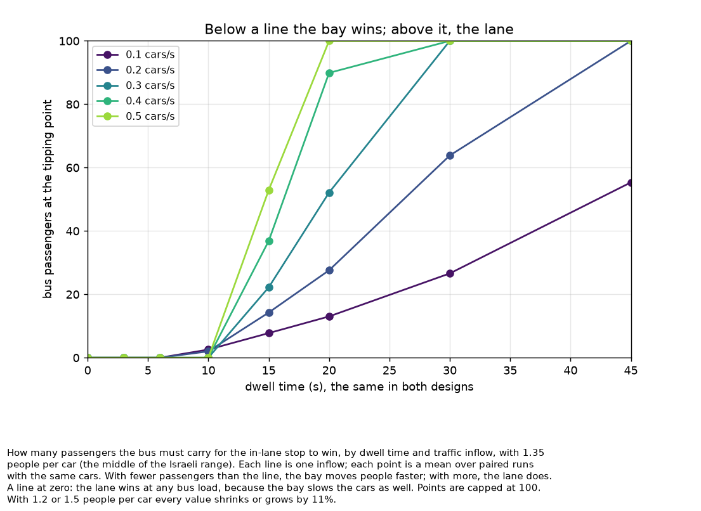

# Results: the bay against the lane

> **Status: two experiments, 19,500 simulated runs.** Stops of 10 to 45 s (15,000 runs, commit
> `fa5ee4c`, 2026-10-31) and short stops of 0 to 6 s (4,500 runs, 2026-11-05). The page
> tells what the simulation showed, lets you [try your own conditions](EXPLORER.md), [checks the simulation against
> field data](FIELD_DATA.md), and ends with [our conclusion](#our-conclusion) and
> [what the simulation leaves out](#what-the-simulation-leaves-out).

## The question, and what we did

[The research question](RESEARCH.md): when does traffic move fastest, when the bus stops in a bay or when it stops in
the lane? To find out, we ran the same road 19,500 times: two designs (the bay, where the trained driver
merges[^merged] back into traffic, and the lane), five traffic inflows (0.1 to 0.5 cars per second), and eight stop
times (0, 3, 6, 10, 15, 20, 30 and 45 s), with 150 to 300 different seeds for each combination.

**The two designs always faced the same traffic.** For a given seed the cars arrive at the same moments, with the same
sizes and the same desired speeds, in both designs, so any difference in the outcome comes from the stop and not from
the luck of the draw.

**People, not vehicles, and the reader picks the people.** The yardstick is person-time: every vehicle's trip, from the
moment it was due to enter the road until it left the other end, multiplied by the people it carries. How many people
ride on the bus and in each car is not something the simulation can decide, and it changes from line to line and hour
to hour, so **nothing on this page assumes a bus load.** For each pair of runs the simulation measures two things:

- **a**, how much longer the bus's trip is with the bay (seconds, paid by every passenger on board);
- **b**, how much longer the trips of all the cars together are with the bay (vehicle-seconds).

The difference is `ΔPT = bus passengers × a + people per car × b`: **below zero, the bay moved people faster.** The
formula is linear, so the stored data answers for any occupancy without a new run. The tables below give the number of
bus passengers at which the two designs tie, and [the explorer](EXPLORER.md) lets you set every value yourself.
Where one car occupancy is needed we use 1.35, the middle of the Israeli range (1.2 to 1.5; see the
[field-data check](FIELD_DATA.md)).

## Chapter 1: what the bay costs the bus

The bay has one price, and the bus pays it: after boarding, the bus must find a gap and merge back. Compared with
leaving at once from a stop in the lane, **the bus's trip is 5.3 to 10.5 s longer in every one of
the 40 cells**, even with no stop at all, and longer when the traffic is denser:

| Bus, bay − lane (s) | 0.1 | 0.2 | 0.3 | 0.4 | 0.5 |
|---|---|---|---|---|---|
| **45 s** | +5.3 | +6.7 | +8.0 | +9.4 | +10.5 |
| **30 s** | +5.5 | +6.5 | +7.4 | +7.9 | +8.4 |
| **20 s** | +5.4 | +6.7 | +7.2 | +7.3 | +7.4 |
| **15 s** | +5.3 | +6.5 | +7.1 | +7.3 | +7.2 |
| **10 s** | +5.5 | +6.4 | +6.8 | +7.1 | +7.3 |
| **6 s** | +5.5 | +6.4 | +6.9 | +7.2 | +7.0 |
| **3 s** | +5.5 | +6.3 | +6.6 | +6.7 | +6.6 |
| **0 s** | +6.2 | +7.7 | +8.6 | +9.0 | +9.2 |

Every passenger on the bus pays these seconds, so the fuller the bus, the more the bay costs.

## Chapter 2: what the bay buys the cars

What the bay buys is for the cars. A bus that stops in the lane stands there for the whole stop, and every car behind it
waits. On a single lane nobody can pass, so a queue forms: from none at all in the shortest stops to **22
cars on average** when the stop is long and the traffic dense, and in the worst cell the longest wait at the entrance of
the road averages 77 s. In the bay the cars drive past the standing bus.

| All cars, bay − lane (vehicle-min) | 0.1 | 0.2 | 0.3 | 0.4 | 0.5 |
|---|---|---|---|---|---|
| **45 s** | −3.6 | −10.7 | −22.4 | −34.9 | −45.4 |
| **30 s** | −1.8 | −5.1 | −11.3 | −18.4 | −24.5 |
| **20 s** | −0.9 | −2.3 | −4.7 | −8.1 | −11.0 |
| **15 s** | −0.5 | −1.1 | −1.9 | −3.3 | −4.7 |
| **10 s** | −0.2 | −0.2 | +0.3 | +1.1 | +1.4 |
| **6 s** | +0.0 | +0.4 | +1.8 | +4.3 | +6.5 |
| **3 s** | +0.2 | +0.8 | +2.7 | +6.5 | +9.9 |
| **0 s** | +0.2 | +1.0 | +3.1 | +7.7 | +12.3 |

The numbers are the cars' total travel time, bay minus lane, in vehicle-minutes per run. The saving grows with the
inflow and the stop time, to about 45 vehicle-minutes in a single run at 45 s and 0.5 cars/s.

**Short stops are the exception.** The bay makes the cars *slower* for stops of 6 s or shorter at every inflow, and at 10 s from 0.3 cars/s: there is little or no queue to
save them from, and they brake for the bus as it pulls back into the lane. With no stop at all, at 0.5 cars/s, the cars
lose about 12 vehicle-minutes in a run.

## Chapter 3: who wins

Put the bus's loss and the cars' gain on the same scale: **the bay wins when the bus carries few enough passengers that
their lost seconds weigh less than the cars' saved minutes.** Each cell below is that tipping point: the number of bus
passengers at which the two designs tie, with 1.35 people per car. With fewer passengers on board, the bay is
better; with more, the lane is.

| Dwell time / inflow (cars/s) | 0.1 | 0.2 | 0.3 | 0.4 | 0.5 |
|---|---|---|---|---|---|
| **45 s** | 55 | >100 | >100 | >100 | >100 |
| **30 s** | 27 | 64 | >100 | >100 | >100 |
| **20 s** | 13 | 28 | 52 | 90 | >100 |
| **15 s** | 8 | 14 | 22 | 37 | 53 |
| **10 s** | 3 | 2 | lane always | lane always | lane always |
| **6 s** | lane always | lane always | lane always | lane always | lane always |
| **3 s** | lane always | lane always | lane always | lane always | lane always |
| **0 s** | lane always | lane always | lane always | lane always | lane always |

*How to read it: each line is one traffic inflow. Below a line the bay moves people faster, above it the lane does. A
line on zero means the lane wins at any bus load. With 1.2 or 1.5 people per car instead of 1.35, every tipping
point shrinks or grows by 11%.*

- **A short stop: the lane, whatever the bus carries.** At stops of 6 s or less the lane wins at
  every inflow, at any bus load and any car occupancy (*lane always*): the bay costs both the bus and the cars. At 10 s
  it is the same from 0.3 cars/s, and below that the bay needs a bus carrying fewer than 3 passengers
  (at 0.1 cars/s) or 2 (at 0.2): practically an empty bus.
- **In between, the bus load decides.** At 15 s and 0.3 cars/s the tipping point is about 22
  passengers; at 0.5 cars/s, about 53. At 20 s and 0.3 cars/s, about 52.
- **A long stop in dense traffic: the bay, unless the bus is full.** At 30 s and 45 s, from 0.3 cars/s, the tipping
  point is above 100 passengers: the queue the bay spares is so long that it wins even for a crowded bus.
- **The emptier the bus, the better the bay.** The bus's loss is counted in people and the cars' gain is not, so every
  passenger fewer on the bus moves the verdict toward the bay.

For readers who want a count rather than a map, here is how the 40 cells split for a few bus loads, with
1.35 people per car (*bay* or *lane* when the 95% interval of the mean lies on one side of zero, *undecided* when
it spans zero):

| Bus passengers | bay wins | lane wins | undecided |
|---|---|---|---|
| **10** | 19 | 21 | 0 |
| **20** | 16 | 23 | 1 |
| **40** | 13 | 26 | 1 |
| **60** | 9 | 30 | 1 |

## Chapter 4: what if the bay stop is longer?

The stop times above are the same in both designs, but a stop in a bay may not be as quick. In the lane the bus stops
in line with the kerb; in a bay it may stop further from the kerb or from the waiting passengers, and boarding takes a
little longer (the [field-data check](FIELD_DATA.md) collects what is known). How much
longer is an assumption, so we paired a lane stop with a *longer* bay stop. Each cell is again the bus load at which the
two designs tie (1.35 people per car):

| Stop in lane / in bay | 0.1 | 0.2 | 0.3 | 0.4 | 0.5 |
|---|---|---|---|---|---|
| **3 / 6 s** | lane always | lane always | lane always | lane always | lane always |
| **6 / 10 s** | lane always | lane always | lane always | lane always | lane always |
| **10 / 15 s** | 2 | 1 | lane always | lane always | lane always |
| **15 / 20 s** | 4 | 8 | 12 | 22 | 32 |
| **20 / 30 s** | 5 | 11 | 22 | 38 | 53 |
| **30 / 45 s** | 7 | 19 | 41 | 66 | 85 |

A bay stop that is only a few seconds longer moves the tipping point down sharply. At 0.3 cars/s, a 15 s lane stop
against a 20 s bay stop ties at about 12 passengers, against 22 when both stops
take 15 s; and a 6 s lane stop beats a 10 s bay stop at any load. **So the bay needs long stops, dense traffic and a
lightly loaded bus to pay for itself, and every second it adds to the stop pushes that further out.**

## How sure are we

- **Every number is a mean over paired runs.** Each cell has 150 pairs (stops of 0 to 6 s) or
  300 (10 to 45 s), and the verdicts use the 95% interval of the mean (normal approximation). The tipping
  points are means; near them single seeds disagree, and the [explorer](EXPLORER.md) shows the interval for any
  choice.
- **The driver's imperfections do not decide it.** The trained driver touches a car in 2.3% of its
  9,750 pull-outs and clips the bay's exit kerb in 8.6%. Leaving out every seed whose bay
  run ended in contact changes the bus's delay by at most 0.4 s and the cars' total by at most
  8 vehicle-seconds, in any cell.
- **Nothing was cut off.** Runs with a vehicle still on the road at the time limit: 0 of
  19,500. The [physics checks](GLOSSARY.md#invariants) found only the bay's known kerb clipping and contacts.
- **Where the data comes from.** The first experiment was measured at commit `fa5ee4c`. The short-stop
  experiment was run from commit `e6969f5` with uncommitted changes in the working tree, as its provenance
  record says; its runs pair with the first experiment's because the arrival schedule depends only on the seed.

## Try it yourself

The chapters above fix some values to tell one story. The [Explorer](EXPLORER.md) tab fixes none: choose the
traffic, the people per car and on the bus, and the stop time in the lane and in the bay, and it answers from the same
stored runs, with the 95% interval.

## Reality check: the simulation against field data

Does what the simulation produces look like what has been measured on real streets? The [Field data](FIELD_DATA.md)
tab compares it, question by question, with published studies, and lists every source. What it means for the results:

- **The direction is supported.** A bay costs the bus a few seconds, and a stop in the lane costs the cars behind it,
  more as the stop gets longer. Both appear in the field data we read, in the same order of magnitude.
- **The corner of long stops and dense traffic does not travel.** There the simulation's queues are far longer than any
  observed, because nobody can overtake on one lane. A two-lane experiment is the most important next step.
- **The limitations pull both ways, and we have not quantified them.** Three favour the bay: one lane with no
  overtaking, no long waits for a gap, and a slow entry. Two favour the lane: the bay's cost to the bus is higher than
  measured, and the stop time is the same in every run (real variation lengthens queues). **So when the simulation says
  "the lane is better", it is on firmer ground than when it says "the bay is better".**

## Our conclusion

**In urban travel, a bus stop in the lane is better.** Inside a city the stops are mostly short: in Israel passengers
validate with an app or a card at every door, and the bus does not stand long. We found no Israeli measurement of stop
times, so this is our judgement, from riding Israeli city buses and from the averages measured abroad (9 to 16 s in
London, 12.4 s in Portland). At short stops the simulation is unequivocal: up to 6 s the lane
wins at any bus load, and at 10 s from 0.3 cars per second. The bay pays for itself only with long stops, dense traffic
and a lightly loaded bus.

**This agrees with the approach that planning guidance takes today:**

- **Israel, Ministry of Transport and Ministry of Construction and Housing**, [*Guidelines for planning streets in cities:
  pedestrian traffic*](https://ilgbc.org/wp-content/uploads/2019/10/PedestrianTrafficPlanning.pdf) (October 2009; a copy hosted by the Israel Green Building Council), section 4.11.3, pp. 83 to 84 (*read*): on urban streets (not roads) the stop should
  preferably be on a kerb extension (an "anti-bay"); without a parking lane "the bus will stop in the lane or in a bay";
  and "the fact that the bus stopping at the stop delays the traffic in that lane for a moment is a traffic-calming
  factor, and directly serves the preference required in city streets for public transport and pedestrians". On urban
  roads and bus lanes, the same section places stops mainly in bays.
- **Transport Today & Tomorrow**, [*Bus stops in the urban space: a guide for local authorities and planners*](https://www.transportation.org.il/sites/default/files/pirsum/tahanot_autobus.pdf) (2014),
  p. 8 (*read*): the alternative preferred for public-transport users is a stop on an anti-bay, so that the bus need not
  leave the road to enter a bay and leave it, and without a parking lane a stop with no bay at all. Among the reasons
  for an anti-bay it lists a drop-off-only or pick-up-only stop, where "the bus does not linger".
- **TCRP Report 19**, [*Guidelines for the Location and Design of Bus Stops*](https://onlinepubs.trb.org/onlinepubs/tcrp/tcrp_rpt_19-b.pdf) (Transportation Research Board, 1996), p. 27
  (*read*): bus bays should be considered when, among other conditions, traffic is faster than 40 mph, the curb lane
  carries more than 250 vehicles in the peak hour, or "average peak-period dwell time exceeds 30 seconds per bus". It
  adds that drivers do not use bays above 1,000 vehicles per hour per lane, because the bus "must wait an unacceptable
  period of time to re-enter the travel lane". Our simulation draws its line in a similar place: the bay starts to win
  at stops of 15 to 30 s, depending on the traffic and the load.
- **Transport for London**, [*Accessible Bus Stop Design Guidance*](https://foi.tfl.gov.uk/FOI-0422-2223/Accessible%20Bus%20Stop%20Design%20Guidance%202017%20Final%20ABSDG.pdf) (revised edition, 2017), section 8, p. 35 (*read*):
  "Bus bays (also known as lay-bys) can present operational problems for buses and they should only be used when there
  are compelling safety or capacity reasons." Kerb build-outs keep the bus in the traffic stream, "as the bus is not
  delayed waiting to rejoin the traffic stream" (p. 32), but should not be used where bus frequency or dwell times
  "will cause delay to following buses and significant delays to general traffic": the same trade-off as our long-stop
  corner.
- **San Francisco**, [TCRP Web Document 19, appendix C](https://onlinepubs.trb.org/onlinepubs/tcrp/tcrp_webdoc_19-b.pdf) (*read*): 62% to 72% of the buses stopped in the lane even where a
  bay existed; bus drivers avoid pulling back out.
- **NACTO**, [*Transit Street Design Guide*](https://nacto.org/publication/transit-street-design-guide/stations-stops/stop-configurations/in-lane-sidewalk-stop/) (*summary only*; the pages refused our download): in-lane stops are preferred
  for transit, and filling in bus bays to make in-lane stops saves buses time.

## What the simulation leaves out

The simulation is, of course, very partial. Streets come in many shapes, and this is one stop on one kind of road:

- **One lane, no overtaking.** The queue behind a bus stopped in the lane is as long as it is because nobody can pass.
  Streets with two or more lanes, with bus lanes, or with a two-way flow that cars can borrow, all change the balance.
  This is the strongest reason not to read the long-stop results as a verdict for real streets. A two-lane version is
  under way.
- **People who park in the bay** ("only for a moment, it won't bother the bus"). A car standing in the bay forces the bus
  to stop in the lane anyway, or to stop at an angle away from the kerb. TfL and the Israeli guidelines both call for
  stopping bans and enforcement for this reason.
- **The road's shape.** Curves, slopes and short sight distances, where traffic cannot see a bus stopped ahead in time
  (TCRP lists this as a reason for a bay).
- **Traffic lights and junctions.** A light upstream sends cars in platoons, with gaps between them that help a bus
  merge; a light downstream builds queues of its own. Whether the stop is before or after the junction matters too.
- **Pedestrian crossings, pedestrians and cyclists.** None are modelled.
- **More than one bus.** No bus behind a bus, no bunching, no limit on how many buses the stop can hold, and no law
  that makes cars yield to a bus leaving a bay (in Florida, a third of the merges happened because a car made way).
- **Stop times that vary.** Every run uses one fixed stop time; on the street it varies a lot.
- **A simple model of the vehicles and of one driver.** No vehicle mass (the bus brakes like a car), no brake lag, cars
  that overshoot when they move aside ([limitations](LIMITATIONS.md)), and one trained driver that still touches a car in
  2.3% of its pull-outs.

So there is plenty left to do. But it is good to see that in our particular case the simulation agrees with the
approach that is common in research today.

## What comes next

1. Run the same experiment on two lanes, where cars may pass a bus stopped in the lane.
2. Measure real stop times at Israeli city stops, in bays and in the lane, instead of choosing them.
3. Add the behaviours listed above, starting with cars parked in the bay, traffic lights and pedestrian crossings.
4. Draw the stop time from a distribution instead of a fixed value.
5. Repeat with a brain that touches cars less, to see how much of the bay's cost is the driver and how much the merge.

The data, the analysis scripts and the design are in the repository: the summary of both experiments is
`results/experiments/stop_design/combined.json` (written by `scripts/summarize_stop_experiments.py`), and the design is
described in [the research question](RESEARCH.md#how-it-will-be-run) and `docs/reference/EXPERIMENT_STOP_DESIGN.md`.

[^merged]: **Merged.** The bus is wholly in the lane (lateral position at least -0.25 m). Judged on traffic only. "Merged" says nothing about the road edges: a merged bus may still have left the road on the way. That is what [strict success](GLOSSARY.md#strict) adds. [more](GLOSSARY.md#merged)
