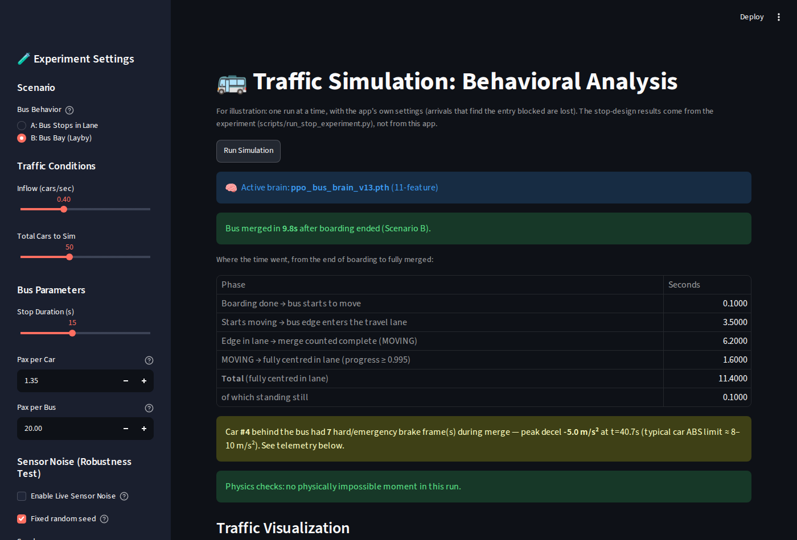
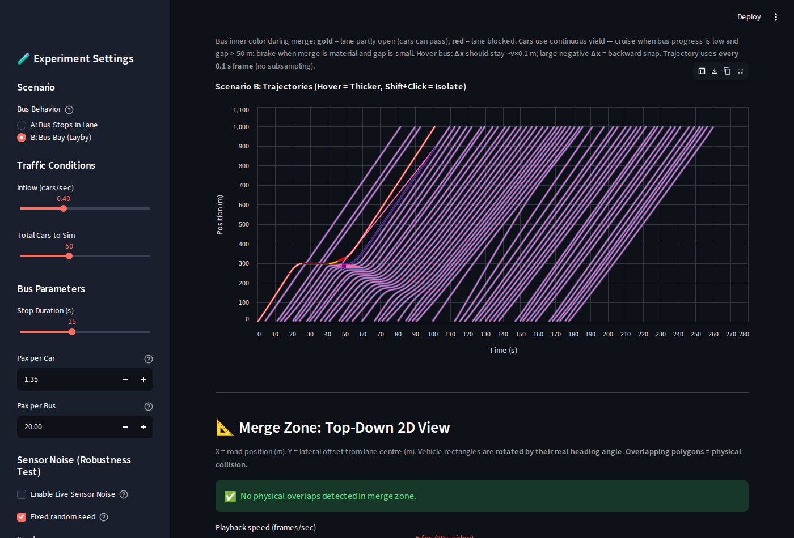

[סקירה](README.md) · [שאלת המחקר](RESEARCH.md) · [מדידות ומחקר](EXPLORER.md) · [מסקנות](RESULTS.md) · [נתוני שטח](FIELD_DATA.md) · [מודל העולם](WORLD.md) · [הסוכן](AGENT.md) · [חקר מקרה](CASE_STUDY.md) · **האפליקציה** · [יומן שינויים](CHANGELOG.md) · [בדיקות](TESTING.md) · [מגבלות](LIMITATIONS.md) · [מילון מונחים](GLOSSARY.md) · [English](../en/APP.md)

> **לקריאה באתר**, שבו הטאבים מתחלפים באותו מקום והכלי האינטראקטיבי עובד: [https://yonizilber.github.io/bus-merge-rl/he/APP.html](https://yonizilber.github.io/bus-merge-rl/he/APP.html)

# האפליקציה

האפליקציה (Streamlit) מריצה הרצה אחת של הסימולציה בהגדרות שבוחרים, ומציגה אותה בפירוט: כמה זמן לקח לאוטובוס להשתלב, לאן
הלך הזמן, ואיך נע כל רכב. [מדידות ומחקר](EXPLORER.md) מסכם אלפי הרצות; האפליקציה מראה הרצה אחת.

האפליקציה רצה במחשב שלכם, ולא באתר הזה או ב-GitHub. איך מתקינים ומפעילים אותה: ב[התחלה המהירה](README.md#התחלה-מהירה)
שבסקירה.

כך היא נראית אחרי הרצה אחת, בהגדרות ברירת המחדל (מפרץ, 0.40 מכוניות בשנייה, עצירה של 15 שניות, seed 0):

*בצד בוחרים תרחיש (A: עצירה בנתיב, B: מפרץ), תנועה, זמן עצירה ותפוסות. למעלה האפליקציה מדווחת כמה זמן לקח לאוטובוס
להשתלב אחרי סוף העלייה, מפרקת את הזמן לשלבים, ומסמנת בלימות חזקות ורגעים לא פיזיקליים (כאן אין).*

*כל קו הוא רכב אחד: המיקום שלו לאורך הכביש (מטרים, בציר האנכי) לפי הזמן (שניות). קו תלול הוא נסיעה מהירה, וקו שמשתטח הוא
רכב שעומד. האוטובוס עוצר במפרץ בערך במטר 300, ושאר הקווים הם המכוניות. מתחת לגרף יש מבט מלמעלה על אזור ההשתלבות.*

---

[סקירה](README.md) · [שאלת המחקר](RESEARCH.md) · [מדידות ומחקר](EXPLORER.md) · [מסקנות](RESULTS.md) · [נתוני שטח](FIELD_DATA.md) · [מודל העולם](WORLD.md) · [הסוכן](AGENT.md) · [חקר מקרה](CASE_STUDY.md) · **האפליקציה** · [יומן שינויים](CHANGELOG.md) · [בדיקות](TESTING.md) · [מגבלות](LIMITATIONS.md) · [מילון מונחים](GLOSSARY.md) · [English](../en/APP.md)

