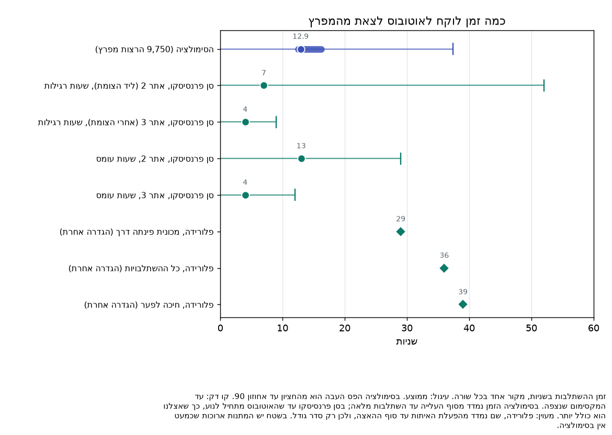
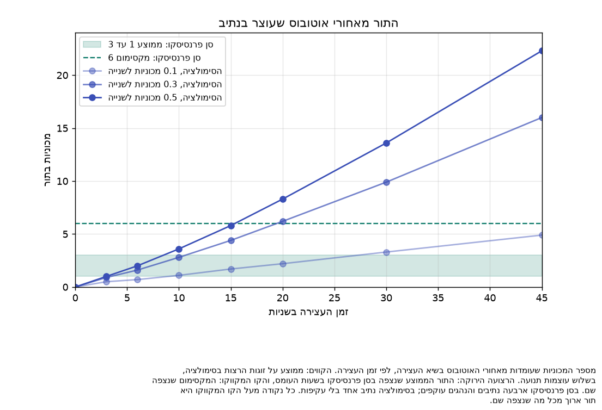
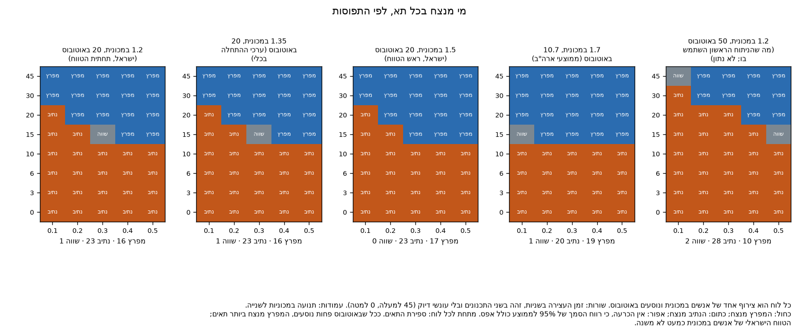

# נתוני שטח: הסימולציה מול רחובות אמיתיים

> **סקירת ספרות, לא כיול מחדש.** נכתב ב-2026-11-01, ועודכן ב-2026-11-10 לשני הניסויים (19,500 הרצות). האם מה
> שהסימולציה מראה על אוטובוס שעוצר במפרץ או בנתיב דומה למה שנמדד ברחובות אמיתיים? בדקנו קודם את מה שהסימולציה **מפיקה**
> (ההפסד של האוטובוס, ההשתלבות, התור, כניסת המכוניות), ואחר כך את מה שהיא רק **מקבלת כקלט** (זמן עצירה, אנשים במכונית
> ובאוטובוס).
>
> *נקרא*: הורדנו את הדוח וקראנו בו את המספרים. *סיכום בלבד*: ראינו רק תקציר ממנוע חיפוש או דף תקציר; יש לאמת מול המקור
> לפני ציטוט. *מיד שנייה*: מצוטט במאמר שקראנו.

## בקצרה

הכיוון הכללי נתמך: מפרץ עולה לאוטובוס כמה שניות בכל עצירה, ועצירה בנתיב עולה למכוניות שמאחוריו, יותר ככל שהעצירה
ארוכה. כמה דברים לא משתחזרים, ואחד תלוי בהנחה שבחרנו. הסימולציה גם לא מדמה שום קושי נוסף להיכנס למפרץ ולהתיישר בו,
ולכן [הכלי](EXPLORER.md) מוסיף את זה כהנחות שאפשר לשנות.

- **המחיר של המפרץ לאוטובוס בסימולציה הוא בקצה העליון של המדידות.** 5.3 עד 10.5 שניות בסימולציה;
  כ-2 עד 6 שניות בשטח. אם המחיר האמיתי נמוך יותר, המפרץ טוב יותר ממה שהסימולציה מראה.
- **אין זנב ארוך בהשתלבות.** הממוצע (12.9 שניות) סביר, אבל המתנות של 30 עד 50 שניות, שנמדדו בשטח, כמעט לא
  מופיעות בסימולציה: 1 מתוך 9,750 הרצות מפרץ.
- **התורים הארוכים הם תוצר של נתיב בודד.** בשטח נהגים עוקפים, והתור הממוצע הוא 1 עד 3 מכוניות; אצלנו הוא מגיע עד
  22.
- **כניסת המכוניות לכביש איטית בכשליש** מזרימת הרוויה הסטנדרטית.
- **ההכרעה תלויה במספר הנוסעים באוטובוס הרבה יותר מאשר באנשים במכונית.** הטווח הישראלי של 1.2 עד 1.5 אנשים במכונית משנה
  תא או שניים; מספר הנוסעים באוטובוס משנה רבים.

## ההכרעה, שאלה אחר שאלה

| שאלה | הסימולציה | השטח | הערכה |
|---|---|---|---|
| כמה המפרץ עולה לאוטובוס | 5.3 עד 10.5 שניות לעצירה, ממוצע 7.0 | סינגפור: +1.6 שניות בהאצה (*נקרא*). אוטווה: 4 עד 5 (*מיד שנייה*) | בקצה העליון של המדידות |
| כניסה למפרץ ויישור | אין הבדל מהנתיב: −0.03 שניות; 2.8 מ' מעמוד התחנה בשניהם | האטה ארוכה ב-0.3 שניות (סינגפור, *נקרא*), 1.4 (בייג'ינג), 1 עד 2 (אוטווה); כל נוסע איטי ב-0.19 שניות (סינגפור) | חסר בסימולציה; הכלי מוסיף אותו |
| ההשתלבות | ממוצע 12.9 שניות, לכל היותר 37.4 | סן פרנסיסקו: 4 עד 13, עד 52 (*נקרא*). פלורידה: 36, בהגדרה אחרת (*נקרא*) | ממוצע סביר, אין זנב ארוך |
| התור מאחורי אוטובוס בנתיב | 0 עד 22 מכוניות | סן פרנסיסקו: 1 עד 3 בממוצע, לכל היותר 6 (*נקרא*) | תואם רק בעצירות קצרות |
| מכוניות שנכנסות לכביש | 1,231 לשעה | זרימת רוויה: 1,900 לשעה לנתיב (*סיכום בלבד*) | נמוך בכשליש |
| ההפסד של המכוניות מעצירה בנתיב | 2 עד 4 שניות למכונית ב-15 שניות | אוטווה: כ-4 שניות למכונית (*סיכום בלבד*) | אותו סדר גודל |
| זמן עצירה | נבחר ישירות, 0 עד 45 שניות | אין מדידה ישראלית. מדידות מחו"ל הן ממערכות אחרות; בישראל אפליקציית תיקוף ועלייה מכל הדלתות מאז 2015 (*נקרא*) | אין נתונים מישראל; הכלי לא מנחש |
| אנשים במכונית | בחירת הקורא; 1.35 כשצריך ערך אחד | ישראל: 1.44 עד 1.52 בסקרים (*נקרא*), 1.2 בכתבות (בלי מקור). ארה"ב: 1.18 לעבודה, 1.67 לכל הנסיעות | בתוך הטווח |
| אנשים באוטובוס | בחירת הקורא | ארה"ב: 10.7 בממוצע (*נקרא*). ישראל: רק מקדמי מילוי; כ-20 לנסיעה בקו עירוני (*סיכום בלבד*) | הערכה, לא מדידה |

## חלק א: מה הסימולציה מפיקה

### 1. כמה האוטובוס מפסיד במפרץ

**הסימולציה:** הנסיעה של האוטובוס ארוכה ב-5.3 עד 10.5 שניות עם מפרץ לעומת עצירה בנתיב, בכל
40 התאים (אותו זמן עצירה בשני התכנונים), כ-7.0 שניות בממוצע.

**השטח.** מחקר בסינגפור (*נקרא*; 16 תחנות בשמונה זוגות של מפרץ ותחנה ליד המדרכה, שעות שיא, 2014, 2,653 רשומות, אתרים
בלי עומס כבד) מצא האצה כולל יציאה של 11.35 שניות במפרץ (סטיית תקן 4.3) מול 9.73 ליד המדרכה (1.9), והאטה של 8.84 מול
8.53. המאמר מצטט גם את אוטווה: האצה ויציאה ארוכות ב-4 עד 5 שניות במפרץ, והאטה ארוכה ב-1 עד 2. הדפים של עיריית אוטווה
עצמם (דוח הייעוץ של Genivar, 2011) כבר לא נפתחים ומפנים לדף ריק; סיכומי החיפוש שמצטטים אותם סותרים זה את זה (5 עד 6
שניות, או 13), ולכן אי אפשר לומר יותר מ"אותו סדר גודל".

**הערכה:** הטווח הנמדד הוא כ-2 עד 6 שניות, והסימולציה בקצה העליון שלו. בסימולציה המחיר גדל עם התנועה; בסינגפור נבחרו
אתרים בלי עומס כבד.

**הכניסה למפרץ עצמה.** מדדנו בסימולציה על 40 זוגות הרצות עם אותה מהירות כניסה ואותה נקודת עצירה: הזמן
מתחילת הבלימה עד שהאוטובוס עומד זהה בשני התכנונים (−0.03 שניות), והמרחק מעמוד התחנה (2.8 מ')
והמרווח מהמדרכה (0.50 מ' בנתיב, 0.46 במפרץ) כמעט זהים. כלומר הסימולציה לא מדמה את הקושי הנוסף
ליישר אוטובוס במפרץ. בשטח ההאטה במפרץ ארוכה ב-0.3 עד 1.4 שניות, וערכי ההתחלה של הכלי מוסיפים שנייה לכניסה, מטר מרחק
ו-0.4 מ' מרווח במפרץ, וכולם ניתנים לשינוי.

### 2. כמה זמן לוקח לאוטובוס להשתלב חזרה

**הסימולציה**, מסוף העלייה עד שההשתלבות[^merged] הושלמה: ממוצע 12.9 שניות, חציון 12.5, 90%
מתחת ל-16.2, 99% מתחת ל-20.7, הארוכה ביותר 37.4. רק 1.4% לוקחות יותר מ-20
שניות. נמדד על 9,750 הרצות מפרץ.

**השטח** (*נקרא*). סן פרנסיסקו: המתנה ממוצעת של 4 עד 13 שניות עד שהאוטובוס מתחיל לנוע, לפי האתר והשעה, ועד 52 שניות.
פלורידה: 36 שניות בממוצע; 29 כשמכונית פינתה דרך ו-39 כשהאוטובוס חיכה לפער.

**ההגדרות שונות.** בסן פרנסיסקו השעון נעצר כשהאוטובוס *מתחיל לנוע*, לפני ההשתלבות עצמה; אצלנו הוא נעצר בסוף ההשתלבות. את
הזמן "עד שמתחיל לנוע" לא שמרנו, ולכן עדיין אין מספר באותה הגדרה. בפלורידה הרחוב מהיר (50 מייל לשעה) ושלנו לא; הדוח שלהם
גם נותן סטיית תקן שלא עקבית בין פסקאות, ולכן לא ציטטנו אותה.

**הערכה:** הממוצע סביר ליד סן פרנסיסקו, רחוב איטי כמו זה שמדומה. אבל לסימולציה אין זנב ארוך: אוטובוס שכמעט אף פעם לא
מחכה הרבה גורם למפרץ להיראות קצת טוב ממה שהוא.

### 3. התור מאחורי אוטובוס שעוצר בנתיב

בסן פרנסיסקו (*נקרא*, קרוב ל-500 הגעות אוטובוס) נוצר תור מאחורי אוטובוס אחת ל-2 עד 17 הגעות, לפי האתר, עם כשינוי נתיב
אחד לכל אוטובוס. עוד נצפה ש-62% עד 72% מהאוטובוסים עצרו בנתיב גם במקום שהיה בו מפרץ: נהגי האוטובוסים נמנעים מהיציאה
חזרה.

**הערכה:** בעצירות קצרות ותנועה קלה, 1 עד 3 מכוניות, הסימולציה תואמת. מעבר לזה התור שלה גדל הרבה מעבר לכל מה שנצפה, כי
בנתיב אחד אי אפשר לעקוף. התאים של עצירה ארוכה ותנועה צפופה, שבהם המפרץ מנצח בבירור, מתארים לכן רחוב עם נתיב אחד ואומרים
מעט על רחוב עם נתיב שני.

### 4. כמה מכוניות נכנסות לכביש

**הסימולציה:** כשיש תור בכניסה, מכונית נכנסת כל 2.3 שניות (חציון), 2.9 בממוצע:
1,231 לשעה, נמדד על 20,741 כניסות. התנועה המבוקשת (0.1 עד 0.5 מכוניות בשנייה) הגיעה בדיוק לפי הלוח.

**השטח** (*סיכום בלבד*): זרימת רוויה של כ-1,900 מכוניות לשעה לנתיב, כ-1.9 שניות למכונית, מצוטטת ממדריכי קורסים ומאמרים;
ה-Highway Capacity Manual עצמו לא נבדק.

**הערכה:** הכניסה בסימולציה איטית בכשליש. כניסה איטית בונה תורים בכניסה מוקדם יותר מהמציאות, וזה מכביד על העצירה בנתיב.
לא בדקנו אם זה משנה את המנצח של תא כלשהו.

### 5. כמה המכוניות מפסידות מעצירה בנתיב

שניות נוספות לכל מכונית כשהעצירה בנתיב ולא במפרץ, לאותן מכוניות (שלילי: בעצירה קצרה המפרץ דווקא האט את המכוניות):

| זמן עצירה / תנועה (מכוניות/שנ') | 0.1 | 0.3 | 0.5 |
|---|---|---|---|
| **45 שנ'** | +14.1 | +29.8 | +36.3 |
| **30 שנ'** | +7.0 | +15.0 | +19.5 |
| **20 שנ'** | +3.4 | +6.2 | +8.8 |
| **15 שנ'** | +2.0 | +2.6 | +3.7 |
| **10 שנ'** | +0.7 | −0.4 | −1.1 |
| **6 שנ'** | −0.1 | −2.4 | −5.2 |
| **3 שנ'** | −0.7 | −3.6 | −7.9 |
| **0 שנ'** | −0.8 | −4.2 | −9.8 |

**השטח** (אוטווה, *סיכום בלבד*): עיכוב של כ-8 שניות למכוניות מעצירה בשפת המדרכה, מול 4 מאוטובוס שיוצא ממפרץ, הפרש של כ-4
שניות; התפוסות והרחוב לא ידועים לנו. **הערכה:** ב-15 עד 20 שניות סדרי הגודל מתאימים, אבל זה צירוף מקרים של סדרי גודל, לא
אימות.

## חלק ב: מה הסימולציה מקבלת כקלט

### 6. זמן העצירה ועונש המפרץ

**זמן העצירה נקבע ישירות, ולא לפי מספר נוסעים.** בניסוי הראשון הוא היה 10 עד 45 שניות, וזה לא ריאלי לעצירה עירונית
טיפוסית, ולכן הרצנו גם עצירות של 0, 3 ו-6 שניות. לא גזרנו את הזמן ממספר הנוסעים, כי המדידות שמצאנו נעשו במערכות אחרות
(למשל כ-3.9 שניות לנוסע בסן פרנסיסקו לפני עלייה מכל הדלתות), ובישראל אפליקציית תיקוף ועלייה מכל הדלתות מקצרות את העצירה
מאוד. לא מצאנו מדידה ישראלית של זמן עצירה, ולכן הכלי נותן לבחור אותו, בנפרד לנתיב ולמפרץ, זהה, או זהה בתוספת עונש
למפרץ. בחו"ל נמדדו זמני עצירה ממוצעים של 9 עד 16 שניות לפי שעות היום באוטובוסים בלונדון (*נקרא*), ו-12.4 שניות בפורטלנד
(*נקרא*).

| הנחה | ערך התחלה | מקור | מצב |
|---|---|---|---|
| מרווח מהמדרכה, לכל נוסע ולכל 10 ס"מ | 0.05 שנ' | בסינגפור נוסע במפרץ לוקח 0.19 שנ' יותר (1.52 מול 1.33); בהנחת הפרש מרווח של כ-40 ס"מ | *נקרא*; ההפרש הוא הערכה |
| מרחק לאורך הרחוב, לכל מטר | 0.4 שנ' (דלת אחת) | הליכה של נוסעים לאורך האוטובוס אל הדלת, כ-1.3 מ' לשנייה, כשרק חלקם מושפעים | הערכה בלי מקור |
| מקדם דלתות לעונשי הדיוק (שתיים / שלוש) | 0.7 / 0.6 | עלייה מכל הדלתות קיצרה את הזמן לנוסע ב-17% עד 38% בסן פרנסיסקו, ונקובר ולוס אנג'לס. בישראל מותר לעלות מכל הדלתות מאז 2015 (מבקר המדינה, 2017, *נקרא*) | הערכה, כמקדם |
| תוספת לזמן הכניסה למפרץ | 1.0 שנ' | האטה ארוכה ב-0.3 שנ' בסינגפור, 1 עד 2 באוטווה ו-1.4 בבייג'ינג; −0.03 בסימולציה | *נקרא* סינגפור; *מיד שנייה* השאר |
| מרחק / מרווח נוספים במפרץ | +1.0 מ' / +0.4 מ' | בסימולציה המרחק זהה (2.8 מ' במפרץ, 2.8 בנתיב) והמרווח כמעט זהה (0.46 מול 0.50 מ') | הערכה |

הכלי משתמש באותם ערכי התחלה, באותם נתונים ובאותה נוסחה, וכל אחד מהם ניתן לשינוי.

### 7. אנשים במכונית ובאוטובוס

| נתון | ערך | מקור | מצב |
|---|---|---|---|
| אנשים ברכב פרטי, ישראל | 1.52 (מטרופולין תל אביב, 2014, 3,000 משקי בית); 1.44 (ירושלים, תל אביב, חיפה והצפון, באר שבע, 2010 עד 2019, 38,500 משקי בית) | משרד התחבורה, הרשות הארצית לתחבורה ציבורית, ריכוז נתונים מרכזיים, יולי 2021, עמ' 21 (סקרי הרגלי נסיעה) | *נקרא* |
| אנשים ברכב פרטי, ישראל, בתקשורת | 1.2 | וואלה (3.11.2019), מיוחס ל"נתוני משרד התחבורה" בלי דוח; גלובס (6.3.2016), אמירה כללית של פורום התחבורה הבינלאומי של ה-OECD על מכוניות, לא נתון ישראלי | *נקרא* בכתבות |
| מילוי אוטובוסים עירוניים, שעות שיא בוקר 2019 | ביותר ממחצית הנסיעות מקדם המילוי בתחנות השיא הוא 60% ומטה | אותו מסמך של משרד התחבורה, עמ' 20 | *נקרא* |
| נוסעים לנסיעה באוטובוס, ישראל | כ-20 בקו עירוני, כ-11 בבין-עירוני, ללא תאריך | ישראל היום | *סיכום בלבד*; הדף לא נפתח |
| אנשים במכונית, ארה"ב | 1.18 לעבודה, 1.67 לכל הנסיעות | FHWA, סקר הנסיעות הלאומי 2017 | *נקרא* |
| נוסעים באוטובוס, ארה"ב | 10.7 בממוצע (5.1 בדאלאס עד 16.8 בניו יורק) | FHWA, מקדמי תפוסה ממוצעת (נתוני 2016) | *נקרא* |

10.7 הוא ממוצע על כל היום והמסלול, לא העומס בתחנה בשעת שיא, ולכן הערך האמיתי בתחנה נתונה נמצא בין הקצוות. הטווח של 1.2
עד 1.5 אנשים במכונית מחבר את המספר הרשמי מהסקרים ואת המספר שמצוטט בכתבות, שלא נמצא מאחוריו דוח; ייתכן שהפער הוא שעות שיא
מול כל הנסיעות, כמו בארה"ב, אבל זו השערה. מקדם מילוי הוא שיעור מהקיבולת, ובמסמך אין מספר מקומות באוטובוס, ולכן "20
באוטובוס" היא הערכה גסה, לא מדידה.

### כמה זה משנה את ההכרעה

ההכרעה לינארית בתפוסות, ולכן חישבנו אותה מחדש מהנתונים השמורים, בלי הרצה חדשה. כאן זמן העצירה זהה בשני התכנונים; הכלי
מוסיף זמני עצירה שונים.

| תפוסה | המפרץ מנצח | הנתיב מנצח | ללא הכרעה |
|---|---|---|---|
| 1.2 במכונית, 20 באוטובוס (ישראל, תחתית הטווח) | 16 | 23 | 1 |
| 1.35 במכונית, 20 באוטובוס (ערכי ההתחלה בכלי) | 16 | 23 | 1 |
| 1.5 במכונית, 20 באוטובוס (ישראל, ראש הטווח) | 17 | 23 | 0 |
| 1.7 במכונית, 10.7 באוטובוס (ממוצעי ארה"ב) | 19 | 20 | 1 |
| 1.2 במכונית, 50 באוטובוס (מה שהניתוח הראשון השתמש בו; לא נתון) | 10 | 28 | 2 |

## מה זה אומר על המסקנות של הניסוי

- **הכיוון נתמך.** מפרץ עולה לאוטובוס כמה שניות, ועצירה בנתיב עולה למכוניות שמאחוריו, יותר עם אורך העצירה. שתי התופעות
  מופיעות בנתוני השטח שקראנו, באותו סדר גודל.
- **פינת העצירות הארוכות והתנועה הצפופה לא עוברת לרחוב אמיתי.** שם התורים בסימולציה ארוכים בהרבה מכל מה שנצפה. ניסוי של
  שני נתיבים הוא הצעד החשוב ביותר הבא.
- **מספר הנוסעים באוטובוס מכריע תאים רבים.** לכן הכלי נותן לבחור אותו, ואת שאר ההנחות, במקום לקבוע ערך אחד.
- **שני חוסרים בדגם מושכים לכיוונים הפוכים.** אין המתנות ארוכות לפער ואין שונות בזמן העצירה. הראשון מחמיא למפרץ, השני
  לנתיב. אין סיבה שיתבטלו זה בזה.
- **לא נבדק:** תהליך ההגעות (פואסון בסימולציה, בקבוצות לפי רמזורים בעיר), חוקים שמחייבים לתת זכות קדימה לאוטובוס (33%
  מההשתלבויות בפלורידה), והכניסה האיטית של הסימולציה.

## צעדים שההשוואה מציעה

- לשמור את הזמן "מסוף העלייה עד שהאוטובוס מתחיל לנוע", כדי להשוות לסן פרנסיסקו באותה הגדרה.
- להגריל זמני עצירה מהתפלגות (ממוצע 12 עד 15 שניות, סטיית תקן כ-9) במקום ערך קבוע.
- להשיג את דוח Genivar המלא (העירייה אומרת שהוא זמין ממזכירות העירייה) ולקרוא בו את המספרים ישירות.
- להריץ את גרסת שני הנתיבים, שבה מכוניות יכולות לעקוף.

## מקורות

המקורות נאספו בחיפוש רשת ב-2026-11-01. כל דוח שמסומן *נקרא* הורד וחולץ ממנו הטקסט. מספרי הסימולציה בעמוד הזה הם מתוך
`results/experiments/stop_design_v1/real_data_comparison.json` (נכתב על ידי `scripts/compare_with_real_data.py`) ו-
`results/experiments/stop_design/combined.json`, ובדיקה אוטומטית בודקת אותם.

- *נקרא*: [Lin et al. (2013), Recommendations for Yield-to-Bus Traffic Control Devices and Bus Pullout Bays Design Characteristics](https://rosap.ntl.bts.gov/view/dot/23357/dot_23357_DS1.pdf), משרד התחבורה של פלורידה, USF CUTR. 42 השתלבויות באתר אחד, 36 שניות בממוצע, 33% עם מכונית שפינתה דרך.
- *נקרא*: [TCRP Web Document 19, נספח C: מחקר לפני ואחרי, מפרץ מול bulb, סן פרנסיסקו](https://onlinepubs.trb.org/onlinepubs/tcrp/tcrp_webdoc_19-b.pdf). טבלאות C-5 ו-C-6 (תורים, שינויי נתיב, זמני עצירה, עיכוב לאוטובוס); הטבלאות הן תמונות בקובץ, ונקראו מהתמונות.
- *נקרא*: [FHWA, Average Vehicle Occupancy Factors](https://www.fhwa.dot.gov/tpm/guidance/avo_factors.pdf). 1.7 למכונית, 10.7 לאוטובוס בממוצע ארצי (נתוני 2016), 5.1 עד 16.8 בין אזורים.
- *נקרא*: [FHWA, 2017 National Household Travel Survey: Summary of Travel Trends](https://www.fhwa.dot.gov/policyinformation/documents/2017_nhts_summary_travel_trends.pdf). טבלה 16: תפוסה לפי מטרת נסיעה.
- *נקרא*: [TfL, FOI R851: Stop Dwell Time (2019)](https://foi.tfl.gov.uk/FOI-1919-2021/R851_Stop_Dwell_Time-2019.pdf). זמני עצירה ממוצעים של 9 עד 16 שניות לפי שעות היום באוטובוסים בלונדון.
- *נקרא*: [Fricker (2010), Bus dwell time analysis using on-board video](https://engineering.purdue.edu/~ce560/HW/Bus_Dwell_Time_jdf.pdf). מצטט את Bertini ו-El-Geneidy: פורטלנד, קו 14, 459 עצירות, ממוצע 12.42 שניות, סטיית תקן 9.23.
- *סיכום בלבד*: [עיריית אוטווה, סקירת מפרצי אוטובוס (ACS2011-ICS-TRA-0010)](https://app06.ottawa.ca/calendar/ottawa/citycouncil/occ/2011/11-23/trc/1-ACS2011-ICS-TRA-0010%20-%20Bus%20Bays%20-%20Operational%20Process%20Review.htm). הקישור מפנה היום לדף ריק; סיכומי החיפוש סותרים.
- *סיכום בלבד*: [Genivar, תקציר מנהלים של דוח המפרצים (2011)](https://app06.ottawa.ca/calendar/ottawa/citycouncil/trc/2011/11-02/1-Document%201%20-%20ACS2011-ICS-TRA-0010-Bus%20Bay%20Report%20Genivar%20Exec%20Summary.pdf). גם הוא דף ריק היום.
- *נקרא*: [Liu, Yang, Meng, Rau (2017), Impact of Different Bus Stop Designs on Bus Operating Time Components, Journal of Public Transportation 20(1)](https://doi.org/10.5038/2375-0901.20.1.6). סינגפור, 16 תחנות, 2,653 רשומות; נקרא מעותק מאורכב, כולל הטבלה שלו על אוטווה, לונדון ובייג'ינג (*מיד שנייה* לגביהן).
- *נקרא*: [וואלה, "תם עידן האזהרות" (3.11.2019)](https://www.walla.co.il/news/israel/3321228). המשפט על 1.2 נוסעים ברכב פרטי.
- *נקרא*: [גלובס, "המכונית היא הון מת" (6.3.2016)](https://www.globes.co.il/news/article.aspx?did=1001108288). המשפט על 1.2 אנשים, מיוחס לפורום התחבורה הבינלאומי של ה-OECD.
- *נקרא*: [משרד התחבורה, הרשות הארצית לתחבורה ציבורית, ריכוז נתונים מרכזיים (יולי 2021)](https://www.gov.il/BlobFolder/reports/special_reports/he/%D7%A8%D7%99%D7%9B%D7%95%D7%96%20%D7%A0%D7%AA%D7%95%D7%A0%D7%99%D7%9D%20%D7%9E%D7%A8%D7%9B%D7%96%D7%99%D7%99%D7%9D%20%D7%91%D7%AA%D7%97%D7%91%D7%95%D7%A8%D7%94%20%D7%94%D7%A6%D7%99%D7%91%D7%95%D7%A8%D7%99%D7%AA-%20%D7%99%D7%95%D7%9C%D7%99%202021.pdf). עמ' 21: 1.52 ו-1.44 אנשים ברכב; עמ' 20: מקדמי מילוי באוטובוסים.
- *נקרא*: [מבקר המדינה (2017), רב-קו](https://library.mevaker.gov.il/sites/DigitalLibrary/Documents/2017-68a-208-RavKav.pdf). עלייה מכל הדלתות מאז 2015.
- *סיכום בלבד*: [מדריך מעבדה, University of Idaho: קיבולת וזרימת רוויה](https://www.webpages.uidaho.edu/niatt_labmanual/Chapters/signaltimingdesign/theoryandconcepts/CapacityAndSaturationFlowRate.htm). 1,900 לשעה לנתיב.

הנחיות התכנון שעליהן נשענת [המסקנה שלנו](RESULTS.md#המסקנה-שלנו) (הנחיות משרד התחבורה לתכנון רחובות, TCRP Report 19,
TfL) מצוטטות בעמוד התוצאות.

[^merged]: **השתלב (merged).** האוטובוס נמצא כולו בתוך הנתיב (מיקום רוחבי של ‎-0.25 מ' לפחות). נשפט לפי התנועה בלבד. "השתלב" לא אומר דבר על שפות הכביש: אוטובוס שהשתלב עדיין יכול היה לצאת מהכביש בדרך. זה מה ש[הצלחה מחמירה](GLOSSARY.md#strict) מוסיפה. [עוד](GLOSSARY.md#merged)
