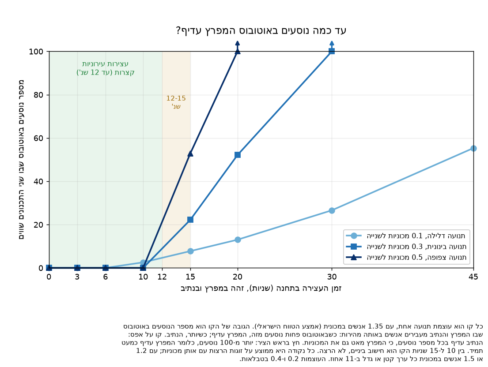

# מסקנות

על סמך 19,500 הרצות מדומות ([מדידות ומחקר](EXPLORER.md)), בדיקה מול [נתוני שטח](FIELD_DATA.md) והנחיות התכנון.

## המסקנה שלנו

> **בנסיעה עירונית, עצירה בנתיב עדיפה.** המסקנה נשענת על הסימולציה ועל המחקר, ועל הנחה עיקרית אחת, והיא חשובה:
> **בתוך העיר בישראל העצירות קצרות יחסית, עד כ-12 שניות, פחות או יותר.** לפי הסימולציה, עד
> 12 שניות עצירה בנתיב כמעט תמיד עדיפה, ובין 12 ל-15 שניות נראה שזה תלוי בעומס התנועה
> בנתיב.

את ההנחה ביססנו על מדידות פזורות שנעשו לצורך יצירת הפרויקט. הן לא פורסמו, ומדידה ישראלית שפורסמה לא מצאנו, ולכן זו
הנחה היוריסטית ולא נתון. היא מתיישבת עם האופן שבו המערכת בישראל עובדת (תיקוף באפליקציה או בכרטיס, עלייה מכל הדלתות)
ועם הממוצעים שנמדדו בחו"ל (9 עד 16 שניות בלונדון, 12.4 בפורטלנד).

בעצירות כאלה הסימולציה ברורה. עד 6 שניות הנתיב מנצח בכל תנועה ובכל מספר נוסעים. ב-10 שניות הוא
מנצח מ-0.3 מכוניות בשנייה, ובתנועה דלילה יותר המפרץ עדיף רק כשבאוטובוס פחות מ-2 עד
3 נוסעים. ב-12 שניות, שלא הורצו אלא חושבו מהתאים של 10 ו-15 שניות (כמו בכלי), המפרץ
עדיף רק כשבאוטובוס פחות מ-5 עד 11 נוסעים, לפי התנועה. ב-15 שניות התנועה
כבר מכריעה: המפרץ עדיף כשבאוטובוס פחות מ-8 נוסעים בתנועה דלילה (0.1 מכוניות בשנייה), ופחות
מ-53 בתנועה צפופה (0.5). החישובים האלה הם עם
1.35 אנשים במכונית ובלי עונשי הדיוק של הכלי, שרק מוסיפים למחיר של המפרץ. המפרץ משתלם רק בעצירות ארוכות יותר,
בתנועה צפופה ובאוטובוס לא מלא. **אם העצירות ארוכות יותר מזה, המסקנה לא חלה**, וה[כלי](EXPLORER.md) מראה מה קורה אז. ובבדיקה מול
[נתוני השטח](FIELD_DATA.md), רוב המגבלות של הסימולציה מטות לטובת המפרץ, ולכן כשהיא אומרת "הנתיב עדיף" היא על קרקע
יציבה יותר מאשר כשהיא אומרת "המפרץ עדיף".

*איך לקרוא: הגובה של כל קו הוא מספר הנוסעים באוטובוס שבו המפרץ והנתיב שווים. כשבאוטובוס פחות נוסעים, המפרץ עדיף;
כשיותר, הנתיב. בתחום הירוק, העצירות העירוניות הקצרות, הקווים צמודים לאפס: הנתיב עדיף כמעט בכל מספר נוסעים. כל
המספרים, לכל חמש עוצמות התנועה, בטבלה של [פרק 3](EXPLORER.md#פרק-3-מי-מנצח).*

### על מה זה נשען

**זה תואם את הגישה של הנחיות התכנון היום.** ההנחיות הישראליות הן המקור היחיד כאן שמחזק את המסקנה ישירות, כי הן נכתבו
לרחובות בישראל:

- **משרד התחבורה ומשרד הבינוי והשיכון**, [*הנחיות לתכנון רחובות בערים: תנועת הולכי רגל*](https://ilgbc.org/wp-content/uploads/2019/10/PedestrianTrafficPlanning.pdf)
  (אוקטובר 2009; עותק באתר המועצה הישראלית לבנייה ירוקה), סעיף 4.11.3, עמ' 83 עד 84: "ברחובות עירוניים (לא
  בדרכים) יש להעדיף" תחנה על הרחבת מדרכה ("אנטי מפרץ"); באין נתיב חנייה "האוטובוס יעצור בנתיב או במפרץ"; ו"העובדה שעצירת
  האוטובוס בתחנה מעכבת לרגע את התנועה באותו נתיב, מהווה גורם הממתן את התנועה, ומשרת באופן ישיר את ההעדפה הנדרשת ברחובות
  העיר לתחבורה הציבורית ולהולכי הרגל". באותו סעיף: "בדרכים עירוניות ובנת"צים, התחנות תמוקמנה בעיקר במפרצים".
- **תחבורה היום ומחר**, [*תחנות אוטובוס במרחב העירוני: מדריך לרשויות מקומיות ולמתכננים*](https://www.transportation.org.il/sites/default/files/pirsum/tahanot_autobus.pdf)
  (2014), עמ' 8: "החלופה המועדפת למשתמשי התח"צ הינה תחנה המוצבת על אנטי מפרץ", כי מפעיל התחבורה הציבורית
  "אינו נאלץ לסטות מהכביש בכניסה למפרץ וביציאה ממנו", ו"באין נתיב חניה, הפיתרון המועדף על משתמשי התח"צ יהיה בנייתה של
  תחנה ללא מפרץ (כאשר האוטובוס עוצר בנתיב)". בין השיקולים לאנטי מפרץ: תחנת הורדה או איסוף בלבד, "והאוטובוס אינו מתעכב
  בה".

### השראה ממקומות אחרים

שאר המקורות באו מתנאים אחרים: מספר נתיבים אחר, רמזורים, הגדרות אחרות. הם משמשים השראה והשוואה
למצבים אחרים, ולא אימות של המספרים שלנו. ברובם הנתיב יוצא עדיף או לא פחות טוב:

- **גרמניה**, ההנחיות לתכנון רחובות RASt 06 ו-EAÖ 2013, כפי שהן מצוטטות ב[מסמך של עיריית בראונשווייג](https://www.braunschweig.de/leben/stadtplan_verkehr/verkehrsplanung/Bauform-von-Bushaltestellen-2019.pdf) (פברואר 2020;
  ההנחיות עצמן *מצוטטות במקור אחר*). ברחוב עם נתיב אחד לכל כיוון, בלי עקיפה, כמו אצלנו, עצירה בנתיב היא ברירת המחדל.
  לפי EAÖ היא "לא בעייתית" לתנועה עד כ-500 עד 710 רכבים בשעה בכיוון, לפי תדירות האוטובוסים, ולפי RASt 06 עד 750. מפרצים
  מומלצים שם בעיקר בדרכים בלי בינוי שבהן המהירות מעל 50 קמ"ש. זה הכביש הדומה ביותר לשלנו, אבל הסף הוא קריטריון של "לא
  בעייתי", ולא מדידה בשניות.
- **לונדון**, ניסוי של TRL עבור TfL (סקרים לפני ואחרי, 2002 ו-2003), [נספח C בהנחיות של TfL מ-2006](https://nacto.org/wp-content/uploads/TfL-accessibile-bus-stop-design-guidance.pdf), עמ' 56 עד 57
 : מילוי מפרץ והפיכתו לתחנה בנתיב חסכו לאוטובוס זמן, ולפי הדוח המלא התועלת לנוסעי האוטובוס גדולה מהנזק לשאר המשתמשים
  בדרך. בעקבות זה TfL ממלאת מפרצים ברחובות עירוניים שהמהירות בהם עד 30 מייל לשעה. המספרים וההשוואה לסימולציה:
  [נתוני שטח](FIELD_DATA.md#1-כמה-האוטובוס-מפסיד-במפרץ).
- **סינגפור**, [Liu ואחרים, 2017](https://doi.org/10.5038/2375-0901.20.1.6): במפרץ האוטובוסים התעכבו יותר מאשר ליד המדרכה. ברחובות עם
  שני נתיבים בכל כיוון, ונמדד רק האוטובוס ([נתוני שטח](FIELD_DATA.md#1-כמה-האוטובוס-מפסיד-במפרץ)).
- **קרואטיה**, [Cvitanić, 2017](https://hrcak.srce.hr/file/275548): סימולציה (CORSIM) מכוילת, נתיב אחד בכל כיוון אבל ליד צומת עם רמזור,
  ועצירות של 15 או 30 שניות. עד כ-800 רכבים בשעה לא נמצא הבדל משמעותי בין עצירה בנתיב למפרץ, ומעל זה המפרץ עדיף.
- **סימולציית VISSIM**, [Dashdamirov ואחרים, 2023](https://doi.org/10.1051/e3sconf/202340101070): אותה שאלה, ברחובות עם 2 עד 4 נתיבים ו-80 עד 180
  אוטובוסים בשעה. ככל שיש פחות נתיבים ויותר אוטובוסים, עצירה בנתיב מאטה יותר את המכוניות; ברחוב עם 4 נתיבים כמעט אין
  הבדל. זמן העצירה לא מדווח, והעיכוב של האוטובוס עצמו לא נמדד.
- **TCRP Report 19**, [*Guidelines for the Location and Design of Bus Stops*](https://onlinepubs.trb.org/onlinepubs/tcrp/tcrp_rpt_19-b.pdf)
  (Transportation Research Board, 1996), עמ' 27: כדאי לשקול מפרץ כאשר, בין השאר, התנועה מהירה מ-40 מייל לשעה,
  בנתיב הימני יותר מ-250 כלי רכב בשעת השיא, או כשזמן העצירה הממוצע בשעות השיא עולה על 30 שניות לאוטובוס. עוד נכתב שם שנהגים
  לא משתמשים במפרץ מעל 1,000 כלי רכב לשעה לנתיב, כי האוטובוס נאלץ לחכות זמן בלתי סביר כדי לחזור לנתיב. הסימולציה שלנו
  מותחת את הקו במקום דומה: המפרץ מתחיל לנצח בעצירות של 15 עד 30 שניות, לפי התנועה ומספר הנוסעים.
- **Transport for London**, [*Accessible Bus Stop Design Guidance*](https://foi.tfl.gov.uk/FOI-0422-2223/Accessible%20Bus%20Stop%20Design%20Guidance%202017%20Final%20ABSDG.pdf)
  (מהדורה מעודכנת, 2017), פרק 8, עמ' 35: מפרצים "can present operational problems for buses and they should only be
  used when there are compelling safety or capacity reasons". הרחבת מדרכה שומרת את האוטובוס בזרם התנועה, כי הוא "is not
  delayed waiting to rejoin the traffic stream" (עמ' 32), אבל אין להשתמש בה כשתדירות האוטובוסים או זמני העצירה יגרמו
  לעיכובים משמעותיים לתנועה: אותו איזון כמו בפינת העצירות הארוכות שלנו.
- **סן פרנסיסקו**, [TCRP Web Document 19, נספח C](https://onlinepubs.trb.org/onlinepubs/tcrp/tcrp_webdoc_19-b.pdf)
 , ברחוב עם ארבעה נתיבים: רוב האוטובוסים עצרו בנתיב גם במקום שהיה בו מפרץ, כי נהגי האוטובוסים נמנעים מהיציאה חזרה
  ([נתוני שטח](FIELD_DATA.md#3-התור-מאחורי-אוטובוס-שעוצר-בנתיב)).
- **NACTO**, [*Transit Street Design Guide*](https://nacto.org/publication/transit-street-design-guide/stations-stops/stop-configurations/in-lane-sidewalk-stop/)
  (*לא אומת מול המקור*): עצירה בנתיב עדיפה לתחבורה ציבורית, ומילוי מפרצים לתחנות בנתיב חוסך זמן
  לאוטובוסים.

## מה הלאה

1. להריץ את אותו ניסוי על שני נתיבים, שבהם מכוניות יכולות לעקוף אוטובוס שעוצר בנתיב.
2. להרחיב את מדידות זמני העצירה בתחנות עירוניות בישראל, במפרץ ובנתיב, ולפרסם אותן, כדי שההנחה שהמסקנה נשענת עליה תהיה
   נתון.
3. להוסיף התנהגויות שהסימולציה לא מדמה, ובראשן מכוניות שחונות במפרץ, רמזורים ומעברי חצייה.
4. להגריל את זמן העצירה מהתפלגות במקום ערך קבוע.
5. לחזור על הניסוי עם מוח שנוגע פחות במכוניות, כדי לראות כמה מהמחיר של המפרץ הוא הנהג וכמה ההשתלבות.

מה הסימולציה לא מדמה, ואיך זה מטה את התוצאה: [מגבלות](LIMITATIONS.md#ניסוי-התחנה). ובכל זאת, משמח לראות שבמקרה הפרטי
שלנו תוצאות הסימולציה תואמות את הגישה של הנחיות התכנון בישראל, ואת הכיוון של רבות מההנחיות והמחקרים בעולם.
